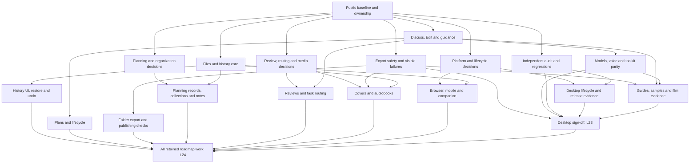

# Concurrent feature delivery

**Updated:** November 8, 2026. **Goal:** finish every retained planned feature, with continuous
independent verification. Source baseline: public `main` at `55b55b8`; the documentation refresh is
tracked in [PR #30](https://github.com/JordanM575/open-book-studio/pull/30).

**Delegated authority, November 7:** the author authorized autonomous feature completion and approved
the coordinator's recommendations: make an evidenced recommendation, record the decision and proceed
without routine approval questions. This includes integrating and merging reviewed feature PRs after
their required checks. It does not turn unfinished research into evidence or override existing
data-protection, spending, credential or release-access restrictions.

**Decision progress:** D-163–D-168 / ADR 0017 now select the planning/organization contracts.
D-193 / ADR 0018 selects the initial scoped-review, exact-citation, reader-profile and overflow
contracts. D-194–D-200 / ADRs 0019–0021 now select bounded full-book workflows, checked conversations,
two explicit cost modes, inline editorial review, recoverable saved reviews and hands-free sessions.
Detailed workflow/review wire schemas precede writers. Broader media/platform decisions remain
individual work; the completed research packets are reused rather than commissioned again.

**Latest delivered foundation:** PR #32 merged the reviewed agent/export corrections; PR #33 merged
the verified saved-history core as `a9997624ac28b970c0a656c50233753ad375982f`. Its exact candidate
passed 2,500 tests and all 12 e2e suites. W02 restore/UI correction `56c7b7d` passed 2,580 tests,
93.12% function / 94.88% line coverage, toolkit build and all 12 e2e suites; fresh independent
review accepted that exact head and PR #34 merged it as `c2089ca`. Host/API mounting remains. W08 core/UI at `320defb` is
independently accepted, with Library/API/Workspace integration next. Expanded journeys remain open.

This execution plan builds on the 25-lane [product DAG](PRODUCT-COMPLETION.md) and
[spec ownership map](SPEC-DAG.md). Its machine-readable work packages are in
[concurrent-delivery.json](concurrent-delivery.json). Work-package arrows order contract delivery;
an open decision listed on a node still gates its dependent implementation even after predecessors
finish. Research can proceed while those decisions are open.

## Capacity and ownership

- **Five concurrent agents**, per the author's latest November 7 direction. The original six-agent
  dispatch below is historical. The current queue is history review, planning integration, pure
  authoring graph/admission, inline editor adapter and pure hands-free contracts, described in
  [Expanded authoring requirements](EXPANDED-AUTHORING-REQUIREMENTS.md). The JSON `currentWave`
  owns the current queue; `firstWave` preserves the initial dispatch.
  The coordinator owns the queue, integration and public completion records. Freed slots take the
  next ready package; five is a concurrency limit, not five permanent assignments.
- **Every new child uses Muse Wonder 1.0 (`muse-wonder-1.0`), reasoning `max`.** The author's
  latest correction supersedes the historical Astra/high dispatch records below.
  This includes fresh review. No silent model/effort substitution. The remaining monthly allowance is a
  capacity note, not a measured token balance or permission for paid application-provider calls.
- **Isolated worktrees for builders.** Each starts from an identified public commit. A branch from
  the older private checkout fails preflight. Research/review agents have read-only source ownership
  and return reports to the coordinator.
- **One integration gate at a time.** Focused tests can run concurrently in isolated trees; full
  application suites and shared fixture infrastructure have one named owner. Keep real profiles,
  credentials and manuscripts outside every test.
- **Shared seams are scheduled explicitly:** `ipc.ts`, preload/API contracts, `schema.ts`,
  `WorkspaceView.tsx`, the central Library service and `docs/FORMAT.md` need a named owner or a queued
  integration patch. No child edits another child's worktree or the coordinator's files.

## Execution DAG

Independent auditing continues on completed candidates; W15 is its initial baseline pass, not a
one-time waiver for later commits. W18 covers the supported desktop matrix. New optional features
receive candidate-specific acceptance when delivered; Android, glasses and audiobook completion
belong to W99 rather than blocking the earlier desktop milestone.

## First wave — historical dispatch

| Slot / package | Bounded output | Owned surfaces and handoff |
| --- | --- | --- |
| Builder 1 · W01 | 032 detailed format/schema and saved-only history core under accepted D-175/D-176; capture/list/read/compare with identity/integrity and archive/trash tests | New core history modules/tests, minimal Library hooks and history-only format/ADR additions. No history UI/IPC yet; restore/undo is W02. Preserve every existing writer safeguard. |
| Builder 2 · W03 | 031 Discuss/Edit enforcement and composer together; wire existing book/one-turn guidance without changing authority | Agent runtime/tool-set, agent contracts, ChatPanel and focused tests. Reuse existing mode fields. No new plan engine, scheduler, live steering or duplicate model chooser. Delivery retains matching demo/runbook condition. |
| Builder 3 · W05 | Reproduce and close current 035 T016/T017 export failure/status gaps across existing formats | Export helpers, FormatDialog/export controls and dedicated tests. First verify whether old header-save/cleanup/image-warning gaps still reproduce. Do not assume T014's folder-packaging policy is accepted. |
| Research 1 · W07 | Decision-ready 030/033 packet: current premises, alternatives, recommendation and failure/acceptance matrix | Read-only source; report only. D-163–D-168 are not accepted by this assignment. Account for D-190 rather than relying on superseded schema assumptions. |
| Research 2 · W09 | Ordered 034/036/037/039/041/042 decision packet, beginning with foreground review scope/citations and media storage/authorization | Read-only source; report only. Identify minimum independent deliverables and precise blocking decisions; preserve U-039-04, unknown-cost semantics and no silent consent. |
| Auditor · W15 | Independently review the DAG/ownership and current file/agent/export contracts; report actionable gaps and candidate test requirements | Read-only source and isolated synthetic verification. Separate known historical findings from reproduced current ones; never claim a clean candidate not actually inspected. |

**W12 is delivered and read**, covering model/browser access, sync trust and placeholders,
Android storage/credentials, iOS/companion capability and D-115/D-172–D-174. Its remaining individual
decisions are coordinator work; no duplicate research assignment is needed.

## Current bounded implementation queue

| Package | Next acceptance slice | Exclusive ownership |
| --- | --- | --- |
| W02 | Real history API/Workspace mounting from accepted, merged `56c7b7d`; prior exact-head broad gates and fresh review pass | History Library/API/IPC/preload/Workspace seams, dedicated tests |
| W08 | Real worldbuilding/goal save/reopen and complete saved-word progress | Planning Library/API/IPC/preload/browser/Workspace seams, dedicated tests |
| W04 | Pure task graph, direction invalidation and finite admission | New `core/authoring` leaves; no storage/runtime/host writer |
| W10 | Minimal plain-text editor adapter and exact-current overlap underlines | New inline editor leaves and dependency manifest/lock only; no mounted editor replacement yet |
| W14 | Pure bound voice session, confirmation/interruption, permission and PCM segmentation | New voice-session leaves; no microphone or host/ambient integration yet |

The coordinator retains W04 stop-consumer/accounting and W10 scoped-core/UI corrections, policy/docs,
integration and broad gates. W08 is the sole shared Library/API/Workspace writer until its handoff.
Candidates receive fresh independent reviews before composition/exposure; leaf acceptance alone is
not a connected author journey. [Retained follow-through](RETAINED-DELIVERY.md) preserves the original
scope that smaller first slices leave open.

## Whole-roadmap coverage and next slices

| Stream | Completion lanes | Sequence after the initial work |
| --- | --- | --- |
| S0 · Coordinator | L00, L23, L24 | Reconcile packets and decisions, schedule shared contracts, integrate/review, exact-candidate acceptance. Every retained lane must reach L24. |
| S1 · Files/history | L02, L07 | Saved-only history → UI → safety-copy/prepared-intent restore → checked undo → interrupted recovery; adapter fault/concurrency and sync-safe behavior throughout. |
| S2 · Agent | L05 | Discuss/Edit/guidance → explicit plans → pause/new-turn continuation/cancel/restart → separately accepted 037 autonomy contracts and implementation. Existing one-turn background opt-in remains distinct. |
| S3 · Export/publication | L04, L11 | Existing export safety → accepted Markdown folder package → remaining import/output conformance → templates/physical layout and named publishing rules only with accepted measurable contracts. |
| S4 · Planning/library | L04, L06, L07 | Accepted planning files/revisions/bounds → manual world/series records → accepted collections/goals/notes and exact stale anchors → scoped context/generation after authority is defined. |
| S5 · Review/routing/media | L05, L08, L09, L10, L13, L14 | Deterministic report completion → selected-source foreground review → structured readers/rereads/continuity; advisory routing → accepted selection/dispatch; front covers → measured wraps; stock narrator → durable chapters → recovery/package → reviewed character casting. Split independent accepted leaf modules across free slots. |
| S6 · Providers/platforms | L03, L12, L15, L16–L20 | Provider/auth/catalog/usage gaps, 038 acceptance and toolkit parity; browser storage/capability → native storage/editor → credentials/voice → device/companion conformance → lifecycle/release evidence. Each platform needs its own proof. |
| S7 · Verification/guides | L01, L21, L22 | Review each changed candidate, adversarial/failure regressions, accessibility/performance/security, guides/samples and exact-artifact film evidence. Keep implementation, automated, live, device and release status distinct. |

The canonical DAG now includes **L06 → L24** explicitly: the author's all-features goal includes
Story Bible/series extensions even if neither optional review nor casting consumes those records.
This repairs a completion-coverage omission; it accepts no storage or generation design. Other
claim-scoped edges retain the explanations in `SPEC-DAG.md`.

## Decision and integration protocol

1. A research report names the current source premise, alternatives, recommendation, exact affected
   tasks, and evidence that would validate or reject it. The coordinator keeps raw reports and
   contested findings before synthesis. Under delegated authority, the coordinator selects the
   supported recommendation, records its alternatives/rationale and accepted scope in the decision
   register, then starts dependent work. Do not mass-accept stale recommendations. Storage, retention,
   permissions and lifecycle choices still need their specific evidence and format/ADR changes.
2. For each builder, record work-package ID, base commit, branch/worktree, owned files, prerequisite
   decisions and one acceptance slice before dispatch. Complete leaf modules first; queue shared
   seam changes for integration rather than running competing writers.
3. A handoff includes commits/diff, behavior delivered, focused checks with actual results, remaining
   gaps, and public-safe documentation. No silent reset, rebase, force-push, baseline weakening or
   overwrite of another candidate. Keep changelog and normative format aligned with code.
4. Review on the exact candidate with a fresh agent using the same requested model/effort; fix small
   findings directly, then recheck affected behavior. Use source/contract tests plus hidden synthetic
   app checks appropriate to the change. Run required typecheck/verify/coverage and affected e2e on
   integrated candidates; add platform/live evidence only with its actual access and authorization.
5. Open/link reviewable PRs and preserve every layer of a stack. The November 7 delegated authority
   covers merging reviewed feature/documentation PRs after their required checks; record that basis
   and exact candidate evidence. Signing and release publication retain their separate restrictions. PR
   check/review waiting is event-driven, not a scheduled polling loop.

## Continuation loop

A single new **30-minute** fallback continuation runs in the existing conversation while T3 is
available. Child-completion notifications remain the primary wake-up. The older cutoff-bound loops
stay disabled; their obsolete instructions and model choices do not govern this new campaign.

At each execution, read the latest private queue/state and current public branch, consume delivered
results once, preserve partial work, and advance or dispatch only unowned ready packages. Prioritize
reproduced data-loss bugs, completing in-flight slices, accepted-decision work, then new packets.
Maintain at most five active children and one integrated full-suite owner. A task awaiting external
access, provider quota or hardware availability parks only its dependent work. Routine design
decisions are researched and resolved under delegated authority rather than parked for questions.

Do not poll running children or use the schedule to poll PR checks. If waiting for a PR's checks or
reviews is the only work, hand off to the PR watch mechanism and pause the fallback. After two
executions with no new actionable work and no active child, disable the new loop and report the
specific external blockers once. Routine decision questions are not a no-progress condition: make an
evidenced recommendation, record it and proceed. Disable on completion or author cancellation as well. There is no inherited
November 5/7 deadline; any new deadline must come from the author. Quota/rate-limit errors stop the
affected dispatch rather than triggering a retry storm or model switch.

The loop operates on synthetic books only. Existing restrictions on the root `json` entry, real
libraries, paid app-provider calls, film uploads, signing and distribution remain. This development
schedule is not authorization for the product itself to gain autonomous background authority.

## Validation

`python3 scripts/validate-completion-specs.py` checks both DAGs, Markdown/JSON edge agreement,
work-package/stream references, coverage of all 25 completion lanes, and unconditional coverage of
the all-roadmap milestone. `workLanes` ties each package to its stream's lane scope; every advertised
stream lane needs assigned work. These are scope references, not proof of disjoint file writes:
the coordinator's exact-file dispatch ledger still governs shared seams. These structural checks do not establish implementation or release
acceptance; the work-package gates and exact-candidate evidence remain required.
For the 039–042 family listed in `newSpecs`, the exact status token is Draft / Planned, In progress
or Implemented, optionally followed by ` — ` and a description. The owning spec must explicitly
move to In progress before checking implemented tasks. The validator rejects completed tasks in
a wholly planned new spec; older specs need task-aware review because decision tasks can be complete.
New-spec
ownership is permanent provenance, not a rule that these features must remain unbuilt forever.
