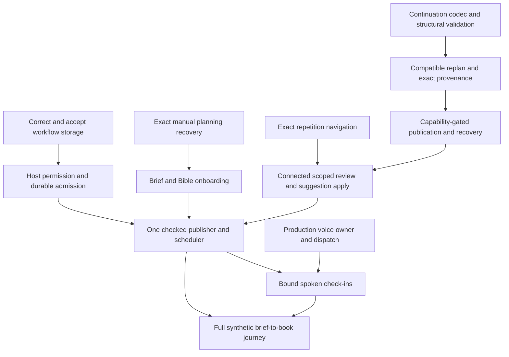

# Delivery forecast — November 8, 2026

**Accepted base:** `19ea1c791c586e64c957f2c43eb379b33d2056e9`, following PR #42.
This forecast orders the next testable slices. It is not a calendar promise or release acceptance.
The [25-lane product graph](PRODUCT-COMPLETION.md) and [20-package execution graph](CONCURRENT-DELIVERY.md)
retain every feature; a prerequisite here is a specific contract, not completion of an unrelated lane.

## Current candidate decisions

| Candidate | Exact head at this snapshot | Evidence and remaining work |
| --- | --- | --- |
| Hands-free Discuss · PR #42 | `20685587867d7281530a6765b106d99998af432a` | Merged as the accepted base above after fresh independent acceptance, Codex, GitGuardian and five exact-head gates. Acceptance covers the synthetic single-realm host seam; production capture/IPC, audio and devices remain open. |
| Workflow storage · PR #43 | `0ed733884a6d394a97634765c8d3c7d52e8f864e` | Corrected delayed verified-note ownership and integrated accepted main. Focused tests pass; fresh independent/Codex review and integrated gates are pending. |
| Manual planning · PR #44 | `ae5a7f37c65b3ad68edf893d731cece3df89421d` | Independent review requires exact line-ending recovery, an exact full-copy representation and stable identities inside order editors. Five gates passed on an unchanged-head rerun; the initial failure remains recorded. |
| Repetition navigation · PR #45 | `1cbe34e9fe50cd1d1e1dcc0e2b58df7deea7832a` | Five gates pass, but independent review requires finding association, complete source-token boundaries and checking/unavailable navigation-read states. |
| Campaign continuation | Documentation candidate; implementation pending | D-201 specifies the continuation contract. Codec, reconstruction/provenance, writer and host integration are not implemented by this candidate. |

PR numbers identify work under review, not shipped features. A changed candidate needs assessment
and gates on its new exact head. Tests from separate candidates overlap and are never summed.

## Next dependency slices

These arrows order the complete combined journey. Selected-source foreground review may proceed
without campaign continuation; typed authoring may proceed without spoken check-ins. Neither can
claim the combined capability until its additional contracts pass.

| Slice / package | Start condition | Deliverable and acceptance boundary |
| --- | --- | --- |
| A · W04 / 037 T023 | Published corrected candidate | Preserve later accepted/newer/uncertain journal decisions while keeping unaccepted outside bytes reviewable. Fresh whole-candidate review and exact-head gates precede merge. |
| B · W08 / 030/033 | Released PR #44 review target | Fresh checked edits recover every valid literal value; exact copies remain available; duplicate order labels map to stable IDs. Verify real browser controls and built adapter journeys. |
| C · W10 / 034 | Released PR #45 review target | A selected occurrence matches its normalized finding and whole tokens. Pending/failed reads visibly disable actionable evidence; stale/live-editor and lifetime protections remain. |
| D → V · W10 / 039 T014/T017 | Accepted D-201 contract; prepared dependencies | Pure exact segmented codec, typed external holes, complete bounds/tamper tests, then compatible replan/content equality. Hash agreement alone never grants planner provenance. |
| S · W10 / 039 T014/T015 | Codec/provenance accepted; adapter capability demonstrated | Intent-first immutable segments and checked manifest, honest uncertain recovery, supported unknown fields, bounded inventories and owner-explicit report reads. Unsupported mutation refuses. |
| H → P · W04 / 037 T020–T025/T029 | Accepted storage and pinned-host settlement contracts | Separate host permission, durable finite admission, one journal-aware checked publisher and event-driven scheduling. Prove revocation, competing edits and every publication crash window. |
| O · W08/W04 / 030/033/037 | Exact planning recovery and canonical brief/Bible mapping | Small returnable onboarding retains direction and the existing saved-word goal. No duplicate progress counter or implicit execution grant. |
| R · W10 / 034/037/039 | Exact source/citation contracts and accepted storage seams | Actual selected-source generation, accessible findings, explicit checked suggestion preview/apply/undo and attributed rereads. Read-only generation and provider-named consent remain enforced. |
| E → K · W14/W04 / 017/037 | Merged synthetic controls and transport; production host contract | Actual capture/IPC ownership and final dispatch admission, truthful close/stop/accounting, then exact question/epoch-bound voice commands. Synthetic tests do not qualify microphones or devices. |
| J · W04/W10/W14 / 037 T039–T042 | Integrated predecessors | Real hidden-app synthetic brief → draft → critique → revisions/check-ins → roughly 70k saved words, including restart. No preseeded output; literary quality is a separate evaluation. |

## Independent work that remains ready to assign

- **W02 / 032:** mount saved-history list/compare/restore/undo through real host draft gates and
  validated API. Core and isolated UI acceptance do not establish this journey.
- **W08 / 003/029/030/033:** canonical Bible fields, series ownership/templates/relationships,
  collections/recents/notes, remaining migration and import formats. Decide unresolved format and
  identity contracts before their writers; preserve all original requirements.
- **W06 / 035:** ordinary ordered Markdown folder export with matter/assets and failure-safe
  destinations, then measurable publishing/layout/template checks. A preview is not measured output.
- **W11 / 019/041/042:** image-result recovery, front-cover composition and recoverable stock-narrator
  chapters. Select each storage/output/consent contract; paid or device qualification needs its own
  authorized evidence. Optional character casting follows successful narrator-only delivery.
- **W13/W16 / 010/014/016/040/009/013:** per-operation browser/native storage, credentials, sync and
  lifecycle contracts; then target-specific device/install/upgrade/recovery checks. Android, glasses
  and release targets remain retained when access is unavailable.
- **W15/W17:** fresh-context documentation review, accessibility/performance and truthful guides,
  samples and exact-artifact film records. Fix findings without weakening gates or deleting failures.

## Completion gates

Use at most five independent children and one broad-suite runner. Shared Library, IPC, Workspace,
format and decision changes have a named owner. Prefer available Linux capacity for new work while
preserving current candidates. Independent review, Codex, GitGuardian and all five exact-head
install/verify/coverage/toolkit/e2e gates precede merges in this campaign.

Implementation, automated, live-provider, device and release evidence have separate records.
**038 T022 stays unchecked.** L23 requires supported desktop sign-off; L24 also requires every
retained extension/platform or an explicit author-approved scope change. Missing external access
parks its dependent check, not unrelated implementation or the retained requirement.
