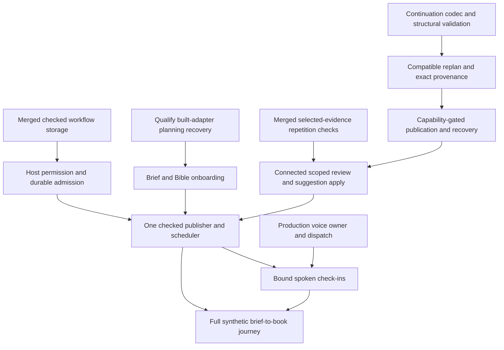

# Delivery forecast — November 9, 2026

**Accepted base:** `c60309577d89853b0c1d66fa42a75ab5eec7fb13`, following PR #63.
This forecast orders the next testable slices. It is not a calendar promise or release acceptance.
The [25-lane product graph](PRODUCT-COMPLETION.md) and [20-package execution graph](CONCURRENT-DELIVERY.md)
retain every feature; a prerequisite here is a specific contract, not completion of an unrelated lane.

## Foundation snapshot and candidate decisions

| Foundation or candidate | Exact head at this snapshot | Evidence and remaining work |
| --- | --- | --- |
| Hands-free Discuss · [#42](https://github.com/JordanM575/open-book-studio/pull/42) | `20685587867d7281530a6765b106d99998af432a` | Merged as `19ea1c7`. The [public evidence register](FOUNDATION-EVIDENCE.md) links the later attribution of independent acceptance, automated/security review and five gates. Scope is the synthetic single-realm host seam; production capture/IPC, audio and devices remain open. |
| Manual planning · [#44](https://github.com/JordanM575/open-book-studio/pull/44) | `ac345ea28dfede2f38e927672fd3ff878d0395b0` | Squash-merged as `6c94273`, including literal-value/full-copy recovery and order-identity corrections. Final-head automated review is public; no equivalent public independent final-head acceptance receipt was located. Built-adapter/native and full 030/033 acceptance remain. |
| Workflow storage · [#43](https://github.com/JordanM575/open-book-studio/pull/43) | `5d80c543868a7ce9dee65de7fe18834653525775` | Merged as `d9b6b16` with [attributed exact-head acceptance and five gates](https://github.com/JordanM575/open-book-studio/pull/43#issuecomment-6732204100). Preserve pending receipt ownership and valid predecessors. Settlement clears entry roots; retained closures/unsettled receipts may retain state. Host execution/recovery remains. |
| Repetition findings · [#45](https://github.com/JordanM575/open-book-studio/pull/45) | `7087a3fffd2c72106335e62c9b642f2f7f434a1d` | Merged as the base above with [attributed exact-head acceptance and five gates](https://github.com/JordanM575/open-book-studio/pull/45#issuecomment-6732818306). Lazy selected-passage verification leaves worker aggregates unverified; direct source-read failures remain distinct. Packaged/native, inline/retained and connected acceptance remain. |
| Campaign continuation | D-201 recorded; continuation seams merged through PR #63 | [D-201](DECISIONS.md#d-201--conditional-campaign-continuation) and [the continuation format](formats/campaign-continuation.md) are recorded. Merged: codec, compatible replan, checked storage, group/archive, fixed-history group move, pure check-in contract, host check-in channel, presenter surface and journey measurement. No real coordinator session exists yet, so the check-in channel and presenter refuse truthfully until one does. Two authoring-contract gaps stay open: no word-count source for check-in targets and no cadence contract. A campaign stage kind is refused as an authoring role and is not mapped onto one. Two gate failures predate the presenter and stay with their owners: the browser editor-focus check and bundle baseline drift. All 039, 037 and 038 task boxes for their gate owners remain unchecked. |

PRs #46/#47's pure planner and saved-review controls precede #42 in first-parent history; #44 then
precedes #43/#45. A missing public acceptance receipt does not establish that no review occurred.
The [foundation register](FOUNDATION-EVIDENCE.md) records exact heads, merges, historical figures
and scoped public attribution. A changed candidate needs assessment and gates on its new exact head.
Tests from separate candidates overlap and are never summed.
The continuation decision and format are recorded in [D-201](DECISIONS.md#d-201--conditional-campaign-continuation)
and [the continuation format](formats/campaign-continuation.md). The codec, compatible replan,
checked storage, group/archive, fixed-history move and check-in seams built on them are merged;
coordinator execution, its two remaining contract gaps and gate-owner task boxes remain open as recorded above.

## Next dependency slices

### Review paths

The continuation row above concerns retained campaign data. Four separate paths retain their own
prerequisites; a storage gate on one path does not suspend all foreground review.

| Path / owner | Required boundary |
| --- | --- |
| Volatile selected-source [039](../specs/039-reader-continuity-review/tasks.md) | No conversation/report writes. Selected-source bounds, provider/data-use disclosure, required consent, citations, read-only runtime enforcement and actual host/UI integration remain independent gates. It does not wait for 037 thread persistence or campaign continuation. |
| Durable conversational [037](../specs/037-guided-autonomous-authoring/tasks.md) | The same selected-source/execution contracts plus disclosed retention through checked, recoverable shared threads and replay exclusion. Thread safety is this path's storage prerequisite. |
| Explicit full-book campaigns [039/037](../specs/039-reader-continuity-review/spec.md#requirements) | Author-selected multi-stage planning/execution, per-call admission and attributed range/category/synthesis coverage. Ordinary overflow refuses; no silent extra calls. Pure planning does not authorize execution or prove storage. |
| Retained campaign continuation [039 T014–T018](../specs/039-reader-continuity-review/tasks.md) | Recorded [D-201](DECISIONS.md#d-201--conditional-campaign-continuation) decision/format. Codec, compatible replan, checked storage, group/archive, fixed-history move, check-in contract/channel/presenter/measurement are merged. Coordinator execution remains: no real coordinator session exists yet, so the check-in channel and presenter refuse truthfully until one does. Two authoring-contract gaps stay open: no word-count source for check-in targets and no cadence contract. A campaign stage kind is refused as an authoring role and is not mapped onto one. A retained plan never grants execution authority. |

[U-039-04 / ADR 0018](adr/0018-scoped-review-contracts.md#reader-profiles-and-bounds) remains a gate
on **both T003 and T006**, including a single oversized chapter. Explicit campaigns partition only
under their own per-call/coverage contracts; ordinary runs never silently clip, summarize or split.

### Combined journey

These arrows order the complete combined journey. Selected-source foreground review may proceed
without campaign continuation; typed authoring may proceed without spoken check-ins. Neither can
claim the combined capability until its additional contracts pass.

| Slice / package | Start condition | Deliverable and acceptance boundary |
| --- | --- | --- |
| A · W04 / 037 T023 | Merged #43 storage foundation | Preserve later accepted/newer/uncertain decisions, separately owned pending receipts and legitimate unsuperseded predecessors during host integration. Unaccepted outside bytes stay reviewable; no fixed heap ceiling or whole-graph collection is claimed. |
| B · W08 / 030/033 | Merged #44 manual recovery corrections | Qualify built-adapter and remaining planning journeys using fresh checked edits, exact literal/full-copy recovery and stable order IDs. Source-component Chromium evidence does not establish the built/native journey. |
| C · W10 / 034 | Merged #45 scanner/navigation | Qualify packaged worker/CSP, native accessibility/IME/navigation and inline/retained integration. Maintain whole-token association, lazy selected-only checks, unverified aggregates and separate direct-read failures; 034 T016/T018/T019 remain open. |
| D → V · W10 / 039 T014/T017 | D-201 contract/format recorded; codec and compatible replan merged | Pure exact segmented codec, typed external holes and bounds/tamper tests are merged, with compatible replan and source validation. Hash agreement alone never grants planner provenance. 039 T014/T017 stay unchecked. |
| S · W10 / 039 T014/T015 | Checked storage, group/archive and fixed-history move merged | Intent-first immutable segments and checked manifest, honest uncertain recovery, supported unknown fields, bounded inventories and owner-explicit report reads are merged. Unsupported mutation refuses. Coordinator execution remains open. |
| H → P · W04 / 037 T020–T025/T029 | Accepted storage and pinned-host settlement contracts | Separate host permission, durable finite admission, one journal-aware checked publisher and event-driven scheduling. Prove revocation, competing edits and every publication crash window. |
| O · W08/W04 / 030/033/037 | Exact planning recovery and canonical brief/Bible mapping | Small returnable onboarding retains direction and the existing saved-word goal. No duplicate progress counter or implicit execution grant. |
| R · W10 / 034/037/039 | Exact source/citation contracts and accepted storage seams | Actual selected-source generation, accessible findings, explicit checked suggestion preview/apply/undo and attributed rereads. Read-only generation and provider-named consent remain enforced. |
| E → K · W14/W04 / 017/037 | Merged synthetic controls and transport; production host contract | Actual capture/IPC ownership and final dispatch admission, truthful close/stop/accounting, then exact question/epoch-bound voice commands. Synthetic tests do not qualify microphones or devices. |
| J · W04/W10/W14 / 037 T039–T042 | Integrated predecessors | Real hidden-app synthetic brief → draft → critique → revisions/check-ins → roughly 70k saved words, including restart. No preseeded output; literary quality is a separate evaluation. |

## Independent work that remains ready to assign

- **W02 / 032:** record reviewed host/editor and adapter-capability contracts before mounting
  saved-history list/compare/restore/undo through real draft gates and validated API. Coordinate
  overlapping public-file ownership first. Core and isolated UI acceptance do not establish this journey.
- **W08 / 003/029/030/033:** canonical Bible fields, series ownership/templates/relationships,
  collections/recents/notes, remaining migration and import formats. Decide unresolved format and
  identity contracts before their writers; preserve all original requirements.
- **W06 / 035:** Markdown folder export is merged and usable on desktop with matter/assets and
  failure-safe destinations; close T016/T017/T019, then measurable publishing/layout/
  template checks. A preview is not measured output.
- **W11 / 019/041/042:** image-result recovery, front-cover composition and recoverable stock-narrator
  chapters. Select each storage/output/consent contract; paid or device qualification needs its own
  authorized evidence. Optional character casting follows successful narrator-only delivery.
- **W13/W16 / 010/014/016/040/009/013:** per-operation browser/native storage, credentials, sync and
  lifecycle contracts; then target-specific device/install/upgrade/recovery checks. Android, glasses
  and release targets remain retained when access is unavailable.
- **W15/W17:** fresh-context documentation review, accessibility/performance and truthful guides,
  samples and exact-artifact film records. Fix findings without weakening gates or deleting failures.

## Completion gates

Use at most five independent children and one broad-suite runner. Shared Library, IPC, Workspace,
format and decision changes have a named owner. Prefer available Linux capacity for new work while
preserving current candidates. Independent review, Codex, GitGuardian and all five exact-head
install/verify/coverage/toolkit/e2e gates precede merges in this campaign.

Implementation, automated, live-provider, device and release evidence have separate records.
**038 T022 stays unchecked.** L23 requires supported desktop sign-off; L24 also requires every
retained extension/platform or an explicit author-approved scope change. Missing external access
parks its dependent check, not unrelated implementation or the retained requirement.
