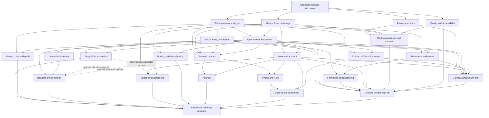

# Open Book Studio — product completion lanes

Original review baseline: public `main` at `f3541f6750e60226ce8490e5ac192f10a1856dab`, November 4.
Current-state reconciliation: November 7, 2026, public `main` at
`55b55b8beae73e4a8f2d1f566c3ad33fccdc6b34`. The JSON retains both dates/baselines. Merged changes
and [dated automated results](TESTING.md#recorded-baseline) inform this update; it is not a fresh
runtime audit, live-provider/device check or release sign-off.
This is a dependency map for remaining work, not a statement that every proposed capability is
implemented or approved. The machine-readable graph is [product-completion.json](product-completion.json).
The [distilled requirements](completion-requirements.json) record stable IDs, current classifications
and acceptance criteria without including private research provenance.
The [spec ownership and dependency map](SPEC-DAG.md) links every requirement and lane to its
existing or new spec, including the four new Draft/Planned proposals 039–042.
The [concurrent delivery plan](CONCURRENT-DELIVERY.md) turns this graph into five active agent slots,
bounded work packages, decision packets and an event-driven continuation loop.

The author's [expanded November 7 requirements](EXPANDED-AUTHORING-REQUIREMENTS.md) explicitly retain
hands-free operation, inline-underlined critique, short-brief onboarding and continuous asynchronous
multi-agent full-book authoring with human check-ins. Four additional requirement IDs map to
L05/L09/L12; the earlier foreground-only review slices do not complete these journeys.

## Two completion milestones

- **L23: desktop release sign-off.** Complete the supported desktop product and its installation,
  safety, accessibility, documentation and release evidence. Planned Android, glasses and audiobooks
  do not block this milestone.
- **L24: requested roadmap complete.** Close or explicitly defer every retained research-derived
  feature and platform lane. Each new capability still needs an accepted spec and relevant decisions.

The published CLI/MCP and ambient voice workflows are existing capabilities. Their lanes finish
conformance and gaps; integrated spec 038 owns the voice preferences. They do not rebuild those features from scratch. The ambient
workflow records on the author's action and speaks the completed answer automatically. Always-on
listening, wake words and barge-in are separate, unimplemented behavior.

## Dependency graph

Solid arrows are 63 unconditional prerequisite edges. Three dashed edges are conditional contracts
with explicit scope in `conditionalDependencies`; they do not gate manuscript-only manual review
or narrator-only audio. The union of both edge types is acyclic.

## Execution and ownership

Use up to six concurrent agents as specified in [CONCURRENT-DELIVERY.md](CONCURRENT-DELIVERY.md):
initially three bounded builders, two decision researchers and one independent auditor.
The graph does not require starting every lane at once. Edges identify required contracts: an
existing verified implementation may already satisfy one while other work in that lane remains.
A lane may implement an independent slice before all predecessors finish; its final acceptance
cannot claim dependent behavior that has not been proven.

1. Reconcile requirements and accepted decisions before creating duplicate feature specs. Keep
   source research private and publish only original, product-focused requirements.
2. Assign each dispatch a tested base, owned files, one acceptance slice and a return artifact.
   Independent code changes use separate prepared worktrees. Keep documentation ownership explicit.
3. Audit the real app throughout: saved files, keyboard paths, permissions, failure states and the
   difference between configured capability and an exercised provider/device. An audit finding
   becomes a bounded follow-up; it does not create a cyclic dependency in this graph.
4. Integrate small changes and run the relevant exact-commit gates. Never lower coverage or a gate,
   alter performance baselines to hide failures, or substitute a lane's earlier result for the
   integrated candidate's evidence.
5. Record actual reported usage/cost. An unreported or zero-filled cost field is not proof that a
   model call was free. New paid workloads, native signing, store submission and hardware tests have
   explicit access/consent boundaries.

The node records define scope, current evidence, dependencies and the exit condition for every lane.
The broad research themes are proposals until the applicable spec/decision is accepted. In
particular, automatic dispatch/fallback, hard spend ceilings, autonomous multi-turn authority,
cross-device trust, real-device distribution and glasses transport are not implied by a graph edge.

### Dependency questions still open

- **L06 → L24 coverage repaired November 7:** the author's all-planned-features direction explicitly
  includes Story Bible/series extensions. The graph now has a direct unconditional edge; optional
  review/casting use cannot silently remove this lane from completion. Its design decisions remain open.
- **Claim-scoped dependencies:** cover inputs for publishing, voice for Android and the supported
  desktop matrix need explicit acceptance scope. The graph's coarse lanes are not permission to
  make every future capability a desktop release blocker, or to skip a prerequisite of a claimed
  capability. Record these interpretations with the acceptance slice before implementation.

The 63 solid and three conditional edges retain the existing claim-scoped interpretations.
Acyclicity and ownership validation prove structural consistency, not that open design decisions
are settled. The execution plan records concrete acceptance slices before dispatch.

## Current next work

### What the November 7 baseline closes

Display branding, damaged-book export refusal, safe chapter moves/restores, book-schema guards,
field-level metadata merging and conflict-copy presentation are merged. Spec 038's profile-local
voice choices are integrated under D-192; it is no longer a reserved candidate. Linux e2e failures
now fail the manual workflow. These completed slices leave wider safety/platform acceptance open.

The README uses [the current demo](https://youtu.be/0RsFzUq97xU); the
[original submission](../hackathon/SUBMISSION.md) retains its original link and dated evidence.
Short cuts, captions, credits and exact-upload playback/privacy/provenance review still need an
artifact-by-artifact record. A link does not establish that the upload matches an inspected draft.

### Proposed delivery sequence

Each row is a bounded next slice in an existing spec, not approval of an unresolved decision or a
promise that all rows must run serially. Start with file-safety contracts and explicit author control;
features with independent contracts can advance without waiting for unrelated roadmap work.

| Work / owner | First deliverable | Prerequisites and acceptance before broadening |
| --- | --- | --- |
| Voice acceptance · 038 / L12 | Complete the author's review of T022's automated record; inventory live microphone/provider/playback gaps separately | T022 stays unchecked until the author closes it. Decide `marin`/`cedar` separately; current catalogs are model-specific. Any paid check needs explicit scope/budget. |
| Named history · 032 / L07 | T001 format/ADR follow-through, T003 record schema, then T004–T006 saved-only capture/list/compare | D-175/D-176 already accepted. Prove identity, body hashes, no draft flush, unknown-field preservation and archive/trash travel. Add T007–T010 checked restore/undo only after fault and interruption boundaries are defined. |
| Agent interaction · 031 / L05 | Enforce the accepted Discuss/Edit boundary and expose the composer choice together | D-177–D-179 already accepted; T004/T010 exist. T006–T009 must prove no writes/plugins in Discuss, unchanged Edit approvals and correct mode attribution. Retain the decisions' matching demo/script/runbook condition; plans and new-turn continuation follow, with no live steering. |
| Planning and organization · 030/033 / L06–L07 | Implement the ADR 0017 checked-sidecar/schema slice, then one manual record journey at a time | D-163–D-168 accepted November 7 after current D-190 premise review. Test failed writes, two writers, foreign identities and exact source anchors before persistence/UI. No automatic series authority. |
| Formatting · 035 / L11 | T014 Markdown folder export from the saved ordered book, with failure-safe destination handling | Keep existing exports usable. Separate future physical layout, templates and named publishing rules; unknown measurements cannot pass KDP/EPUB/PDF readiness. |
| Review · 034/037/039 / L08–L09 | Finish deterministic saved-text evidence; develop the explicit foreground, selected-source review boundary before structured readers | D-171 gates report persistence/export; 037 scope/consent questions and U-039-01/02/04 gate dependent model work. Start with one volatile selected-source report, then attributed rereads and explicit cross-book scope. No automatic edits or routing. |
| Routing · 036 / L14 | Resolve taxonomy, capability/price evidence and author selection around the existing offline preview | Preview remains zero-call/zero-write. Dispatch, fallback, retry and hard spend enforcement each need their accepted policy; D-116 is not an implemented ceiling. |
| Cover design · 041 / L10 | Existing art → saved front-cover composition → approximate preview → independently measured export | U-041-01/02 govern storage/output. Prove original-asset/manuscript preservation and failed-export recovery. Print wraps need measured pagination/paper inputs; generation waits on U-041-03. |
| Audiobooks · 042 / L13 | Stock narrator/script approval, then one recoverable chapter render | Reuse integrated 038 and lower-level TTS helpers; U-042-01/03 gate requests, U-042-02 storage/recovery and U-042-04 packaging. Test partial/uncertain requests, no paid retry without consent, stale audio and reuse of successful chapters before optional character casting. |
| Desktop release · 009/013 / L20–L23 | Accepted support/lifecycle matrix and candidate-specific install/upgrade/recovery evidence | D-115 and D-172–D-174 retain their scopes. Recheck D-174 against D-189's profile recovery text before any cleanup design. Signing/distribution need approval; test library/profile preservation and newer-schema refusal. L23 can close without Android/glasses/audiobooks. |
| Browser, iOS, Android, glasses · 010/014/016/026/040 / L16–L19 | Per-target capability/refusal matrix; Android shell/storage decision packet and editor-only slice | Resolve actual storage/permission/credential limits; 040 U-01/02 before Android writes, U-03 before providers/voice, U-04 before release. Keep emulator, real-device and distribution evidence distinct. D-160's private companion transport is not implemented by a responsive demo. |

### Decision packets and handoff contract

For each open decision, prepare: the current source/spec premise, alternatives, recommended outcome
with tradeoffs, affected tasks, and a synthetic acceptance/failure matrix. Keep the recommendation
labelled proposed until accepted in `DECISIONS.md`; do not choose a storage path, quota, SDK, voice
policy or release target by implication. The expanded plans in 039–042 specify these research outputs
and their first delivery checkpoints.

An implementation handoff names its base commit, owned files, applicable accepted decisions, one
author-visible deliverable and exact acceptance tests. Completion evidence names the tested commit
and target, commands/results and remaining limits. Mock/provider contracts, live requests, native
devices and release approval get their own records. Retain failed results and contested remedies.

The U-039-04 gate remains on T003: overflow can affect a single large chapter as well as multi-book
work. D-193 / ADR 0018 now accepts the shared bounded-envelope policy and rejects a single-book
exemption. Pure review contracts can proceed; shared thread safety and provider/UI integration
remain implementation prerequisites, and later persistence/autonomy decisions remain separate work.

Release links belong in the repository only when their artifacts are ready. A configured installer,
responsive viewport, Simulator capture or successful submission is not by itself release evidence.
