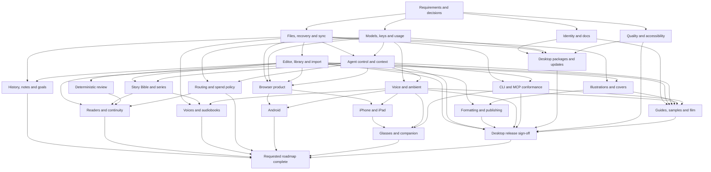

# Open Book Studio — product completion lanes

Reviewed against public `main` at `f3541f6750e60226ce8490e5ac192f10a1856dab` on 2026-11-05.
This is a dependency map for remaining work, not a statement that every proposed capability is
implemented or approved. The machine-readable graph is [product-completion.json](product-completion.json).
The [distilled requirements](completion-requirements.json) record stable IDs, current classifications
and acceptance criteria without including private research provenance.

## Two completion milestones

- **L23: desktop release sign-off.** Complete the supported desktop product and its installation,
  safety, accessibility, documentation and release evidence. Planned Android, glasses and audiobooks
  do not block this milestone.
- **L24: requested roadmap complete.** Close or explicitly defer every retained research-derived
  feature and platform lane. Each new capability still needs an accepted spec and relevant decisions.

The published CLI/MCP and ambient voice workflows are existing capabilities. Their lanes finish
conformance, preferences and gaps; they do not rebuild those features from scratch. The ambient
workflow records on the author's action and speaks the completed answer automatically. Always-on
listening, wake words and barge-in are separate, unimplemented behavior.

## Dependency graph

## Execution and ownership

Use four concurrent lanes where useful: three bounded builders/researchers and one real-app auditor.
The graph does not require starting every lane at once. Edges identify required contracts: an
existing verified implementation may already satisfy one while other work in that lane remains.
A lane may implement an independent slice before all predecessors finish; its final acceptance
cannot claim dependent behavior that has not been proven.

1. Reconcile requirements and accepted decisions before creating duplicate feature specs. Keep
   source research private and publish only original, product-focused requirements.
2. Assign each dispatch a tested base, owned files, one acceptance slice and a return artifact.
   Independent code changes use separate prepared worktrees. Keep documentation ownership explicit.
3. Audit the real app throughout: saved files, keyboard paths, permissions, failure states and the
   difference between configured capability and an exercised provider/device. An audit finding
   becomes a bounded follow-up; it does not create a cyclic dependency in this graph.
4. Integrate small changes and run the relevant exact-commit gates. Never lower coverage or a gate,
   alter performance baselines to hide failures, or substitute a lane's earlier result for the
   integrated candidate's evidence.
5. Record actual reported usage/cost. An unreported or zero-filled cost field is not proof that a
   model call was free. New paid workloads, native signing, store submission and hardware tests have
   explicit access/consent boundaries.

The node records define scope, current evidence, dependencies and the exit condition for every lane.
The broad research themes are proposals until the applicable spec/decision is accepted. In
particular, automatic dispatch/fallback, hard spend ceilings, autonomous multi-turn authority,
cross-device trust, real-device distribution and glasses transport are not implied by a graph edge.

## Current next work

Research reconciliation recommends reusing the existing specs rather than duplicating them. The
next genuinely new proposals are structured reader/continuity review (039), Android (040),
dedicated cover design (041), and narrator/character casting with audiobook creation (042).
These numbers are a proposed sequence, not a claim that those specs or features have landed;
038 remains owned by the voice-options candidate. Publishing validation extends 035 and depends
on measured output/rule contracts; conversational review remains distinct under 037.

- Reconcile spec headers/index/task evidence and remove stale claims of missing implementations.
- Finish the Open Book Studio display rename without changing credential or data identities.
- Integrate the tested voice-options candidate and recheck the supported flow in the public checkout.
- Complete a film with library-to-book navigation, distinct features and labelled multi-chapter
  fixture flips; preserve the submitted upload while its replacement is reviewed.
- Prioritize unresolved data-safety contracts before broadening agent authority or remote surfaces.

Release links belong in the repository only when their artifacts are ready. A configured installer,
responsive viewport, Simulator capture or successful submission is not by itself release evidence.
