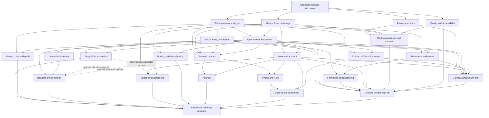

# Open Book Studio — product completion lanes

Original review baseline: public `main` at `f3541f6750e60226ce8490e5ac192f10a1856dab`, November 4.
Current-state reconciliation: November 9, 2026, public `main` at
`0fc19f39189aab078c687178060cedf968b5359e` (PR #45), plus explicitly labelled candidate/decision
follow-through. The JSON retains the original audit baseline. Merged changes
and [dated automated results](TESTING.md#recorded-baseline) inform this update; it is not a fresh
runtime audit, live-provider/device check or release sign-off. The
[foundation evidence register](FOUNDATION-EVIDENCE.md) distinguishes final heads, merge commits,
publicly attributed independent acceptance and automated review.
This is a dependency map for remaining work, not a statement that every proposed capability is
implemented or approved. The machine-readable graph is [product-completion.json](product-completion.json).
The [requirements](completion-requirements.json) record stable IDs, current classifications
and acceptance criteria.
The [spec ownership and dependency map](SPEC-DAG.md) links every requirement and lane to its
existing or new spec; 039 is now In progress, while 040–042 remain Draft/Planned.
The [spec index](../specs/README.md) links their plans/tasks; the [decision register](DECISIONS.md)
records which contracts are accepted and which choices remain open.
The [concurrent delivery plan](CONCURRENT-DELIVERY.md) turns this graph into up to five child slots,
bounded work packages, decision packets and an event-driven continuation loop.

The author's [expanded November 7 requirements](EXPANDED-AUTHORING-REQUIREMENTS.md) explicitly retain
hands-free operation, inline-underlined critique, short-brief onboarding and continuous asynchronous
multi-agent full-book authoring with human check-ins. Four additional requirement IDs map to
L05/L09/L12; the earlier foreground-only review slices do not complete these journeys.

## Two completion milestones

- **L23: desktop release sign-off.** Complete the supported desktop product and its installation,
  safety, accessibility, documentation and release evidence for the explicitly supported feature and
  target matrix. Planned Android, glasses and audiobooks do not block this milestone. A capability
  omitted from that matrix remains open in its full retained lane; see the
  [milestone tradeoffs](PRODUCT-MAP-DESIGN.md#release-milestone-alternatives).
- **L24: requested roadmap complete.** Close every retained feature/platform lane with acceptance
  evidence, or record an explicit author-approved scope change. Delegated engineering decisions do
  not permit quiet deferral. Its separate direct acceptance conjunction covers every lane L00–L23;
  the eight incoming sequencing arrows do not replace it. [Retained follow-through](RETAINED-DELIVERY.md)
  owns original omissions. The [map rationale](PRODUCT-MAP-DESIGN.md) compares this two-milestone
  choice with one all-target sign-off.

The published CLI/MCP and ambient voice workflows are existing capabilities. Their lanes finish
conformance and gaps. [038](../specs/038-voice-options/spec.md) owns profile-local voice preferences;
[017](../specs/017-voice-and-background/spec.md) owns background and explicit-session behavior.
The current ambient workflow records when the author starts and stops it, then attempts a spoken
reply. An unavailable selected route, provider refusal or playback failure can prevent audio; see
[Voice](VOICE.md). Qualified interruption within an explicitly activated session remains retained
production work. Unrequested always-listening or wake-word capture remains outside the contract.
The merged Discuss controls have synthetic in-process host evidence; that does not qualify connected
native capture, microphones or playback.

## Dependency graph

The 63 solid arrows gate applicable upstream **contracts** for whole retained-lane acceptance, not
all independent implementation slices. Three dashed edges are independent conditional contracts
with exact scope in `conditionalDependencies`. Manuscript-only review does not require new planning
records; manual provider/model selection does not require routing; narrator-only audio does not
require new character records. The union is acyclic. The
[edge acceptance register](PRODUCT-ACCEPTANCE-GATES.md) names each claim, owner, required evidence
and refusal; it does not assert that any evidence passed. The distinct L24 direct conjunction is not
drawn as sequencing arrows. See the [map rationale](PRODUCT-MAP-DESIGN.md) for the alternatives and
tradeoffs.

## Execution and ownership

Use up to five concurrent **children** and a separate coordinator; broad suites have one runner at a
time, as specified in [CONCURRENT-DELIVERY.md](CONCURRENT-DELIVERY.md). The requested child route is provider
`opencode`, model `openai/gpt-6.1-terra`, variant `max`; this records requested settings, not measured
effective inference effort. The original six-agent wave is historical.
The graph does not require starting every lane at once. Edges identify required contracts: an
existing verified implementation may already satisfy one while other work in that lane remains.
A lane may implement an independent slice before all predecessors finish; its final acceptance
cannot claim dependent behavior that has not been proven.

1. Reconcile requirements and accepted decisions before creating duplicate feature specs. Publish
   product-focused requirements with explicit owners and acceptance criteria.
2. Assign each dispatch a tested base, owned files, one acceptance slice and a return artifact.
   Independent code changes use separate prepared worktrees. Keep documentation ownership explicit.
3. Audit the real app throughout: saved files, keyboard paths, permissions, failure states and the
   difference between configured capability and an exercised provider/device. An audit finding
   becomes a bounded follow-up; it does not create a cyclic dependency in this graph.
4. Integrate small changes and run the relevant exact-commit gates. Never lower coverage or a gate,
   alter performance baselines to hide failures, or substitute a lane's earlier result for the
   integrated candidate's evidence.
5. Record actual reported usage/cost. An unreported or zero-filled cost field is not proof that a
   model call was free. New paid workloads, native signing, store submission and hardware tests have
   explicit access/consent boundaries.

The node records define scope, current evidence, dependencies and the exit condition for every lane.
The broad research themes are proposals until the applicable spec/decision is accepted. In
particular, automatic dispatch/fallback, hard spend ceilings, autonomous multi-turn authority,
cross-device trust, real-device distribution and glasses transport are not implied by a graph edge.

### Dependency questions still open

- **L06 → L24 coverage repaired November 7:** the author's all-planned-features direction explicitly
  includes Story Bible/series extensions. The graph now has a direct unconditional edge; optional
  review/casting use cannot silently remove this lane from completion. D-163–D-168 select the first
  manual planning/organization contracts; series/generated follow-on decisions remain individual work.
- **Claim-scoped dependencies:** cover inputs for publishing, voice for Android and the supported
  desktop matrix have explicit applicability and refusal cases in the
  [edge acceptance register](PRODUCT-ACCEPTANCE-GATES.md). The graph's coarse lanes are not
  permission to make every future capability a desktop release blocker, or to skip a prerequisite
  of a claimed capability. Acceptance still requires the applicable evidence and decisions.

The 63 solid and three conditional edges retain the existing claim-scoped interpretations.
A separate direct L24 conjunction requires all retained lanes L00–L23, not just the eight incoming
arrows or their transitive predecessors. Acyclicity and ownership validation prove structural
consistency, not that evidence passed or open design decisions are settled. The
[map rationale](PRODUCT-MAP-DESIGN.md) explains the selected boundaries; the execution plan records
concrete acceptance slices before dispatch.

## Next work

### What the November 9 baseline includes

Display branding, damaged-book export refusal, checked chapter moves/restores, book-schema guards,
field-level metadata merging and conflict-copy presentation are merged. Spec 038's profile-local
voice choices are integrated under D-192; it is no longer a reserved candidate. Linux e2e failures
now fail the manually dispatched workflow; it is not an enforced PR merge gate. These completed
slices leave wider concurrent-writer and platform acceptance open.

Merged foundations include checked v1 conversations, the plain-text editor/evidence adapter,
cancellable voice transport, saved-review records and controls, pure full-book campaign planning,
and the synthetic hands-free Discuss seam. Their remaining host, provider, continuation and device
gates are explicit in the owning tasks. Workflow storage, manual planning and repetition findings
merged in PRs #43–#45. Public final-head independent acceptance is attributed for #43/#45;
no equivalent public receipt was located for #44, whose automated review is separate. That does not
establish that no independent review occurred. PRs #46/#47 precede #42 in first-parent history.
See the [dated delivery forecast](DELIVERY-FORECAST.md) for exact heads, prerequisites and next work;
neither a merged leaf nor a passing test suite completes an entire lane.

Workflow settlement releases receipt entry roots and registry entries; outstanding receipts or
retained closures may still reference captured state. Independently owned pending receipts and
legitimate unsuperseded predecessors retain their ownership rules. Saved-review quotations remain
verified-at-capture; lazy selected-passage verification leaves worker aggregates unverified and does
not establish report completeness. These limits accompany the linked exact-head evidence.

The README uses [the current demo](https://youtu.be/0RsFzUq97xU); the
[original submission](../hackathon/SUBMISSION.md) retains its original link and dated evidence.
Shorter video cuts, captions, credits and exact-upload playback/privacy/provenance review still need an
artifact-by-artifact record. A link does not establish that the upload matches an inspected draft.

### Proposed delivery sequence

Each row is a bounded next slice in an existing spec, not approval of an unresolved decision or a
promise that all rows must run serially. Start with file-safety contracts and explicit author control;
features with independent contracts can advance without waiting for unrelated roadmap work.

| Work / owner | First deliverable | Prerequisites and acceptance before broadening |
| --- | --- | --- |
| Voice acceptance · [038 tasks](../specs/038-voice-options/tasks.md), [017 tasks](../specs/017-voice-and-background/tasks.md) / L12 | Complete the author's review of T022's automated record; qualify production session/interrupt paths and inventory microphone/provider/playback gaps separately | T022 stays unchecked until the author closes it. Separately decide whether to add `marin` and `cedar` to the model-specific local catalogs described in [Voice](VOICE.md); neither is approved here, and local membership is not live availability. Paid checks need explicit scope/budget. |
| Named history · [032 tasks](../specs/032-chapter-history/tasks.md) / L07 | Record reviewed host/editor and adapter-capability contracts, then qualify API/Workspace mounting | Saved-only core merged in #33; [#34's receipt](https://github.com/JordanM575/open-book-studio/pull/34) attributes independent acceptance and 2,580 verify/coverage/12 e2e to `56c7b7d`. This covers checked restore/undo core and isolated injected UI, not real draft gates, host mounting, confirmation/recovery or retention. Historical results stay at that head. |
| Agent interaction · [031 tasks](../specs/031-agent-interaction/tasks.md), [037 tasks](../specs/037-guided-autonomous-authoring/tasks.md) / L05 | Integrate host permission/admission, execution and one checked publisher over merged workflow storage | [#43's acceptance](https://github.com/JordanM575/open-book-studio/pull/43#issuecomment-6732204100) covers `5d80c54`; checked v1 threads and pure graph/admission are also merged. Backed-up v2 migration and real scheduling remain. 037 T018–T042 own the connected journey. [ADR 0019's alternatives](adr/0019-bounded-autonomous-authoring.md#alternatives-and-consequences) explain checked host publication, author control, recovery and its coordination costs. |
| Planning and organization · [030 tasks](../specs/030-story-bible-extensions/tasks.md), [033 tasks](../specs/033-library-organization/tasks.md) / L06–L07 | Qualify built-adapter recovery and the remaining manual planning journeys | Worldbuilding/goal integration and #44's literal-value/full-copy/order-identity corrections are merged. Its [public evidence limits](FOUNDATION-EVIDENCE.md#exact-heads-and-public-attribution) are explicit. D-163–D-168/ADR 0017 governs checked save/reopen, conflicts and bounds. Full Bible/series/collections/anchors and native accessibility remain owned. |
| Formatting · [035 tasks](../specs/035-book-formatting/tasks.md) / L11 | Pure Markdown folder planner, then host capture/publication, from the saved ordered book | The packaging contract is recorded in [D-202](DECISIONS.md#d-202--markdown-folder-export-pure-planner-contract-and-saved-source-bundle) and [the folder format](formats/markdown-folder.md); implement its T014-P planner and T014-Q0/Q host gates before exposing the journey. Keep existing exports usable. Physical layout, templates and named publishing rules remain separate; unknown measurements cannot pass KDP/EPUB/PDF readiness. |
| Volatile selected-source review · [039 tasks](../specs/039-reader-continuity-review/tasks.md), [034 tasks](../specs/034-manuscript-review/tasks.md) / L08–L09 | Connect disclosed saved-source snapshots, verified citations and read-only generation to the actual host/UI | Independently enforce selected-source bounds, provider/data-use disclosure, required consent, zero-send cancel and runtime read-only scope. This path writes no conversations or reports and does not wait for 037 thread storage or retained campaign continuation. Editor/verifier leaves do not establish connected acceptance. |
| Durable conversational review · [037 tasks](../specs/037-guided-autonomous-authoring/tasks.md) / L05 | Integrate disclosed review inputs/results into the checked conversation path | Shared thread safety, versioned parts, recovery and replay exclusion gate this persistence path under [ADR 0018](adr/0018-scoped-review-contracts.md#accepted-envelope-and-execution-boundary). Selected-source and consent/runtime gates still apply. It is distinct from volatile 039 reports. |
| Explicit full-book campaigns · [039 tasks](../specs/039-reader-continuity-review/tasks.md), [037 tasks](../specs/037-guided-autonomous-authoring/tasks.md) / L09/L05 | Connect all-range planning, per-call admission and attributed coverage/synthesis to separately authorized execution | Ordinary overflow refuses. Only an explicit campaign may partition under its per-call and coverage contracts; no silent extra calls or invented token-fit guarantee. Pure planner acceptance does not establish scheduling, storage or provider quality. |
| Retained campaign continuation · [039 T014–T018](../specs/039-reader-continuity-review/tasks.md) / L09 | Record and independently review the public continuation contract/format, then implement exact reconstruction and recovery | D-201 remains a separate candidate at this snapshot. Reviewed public decision/format incorporation precedes writers. Codec/provenance, capability-gated storage and host/UI evidence are separate gates; this row governs retained continuation, not every review run. |
| Routing · [036 tasks](../specs/036-task-aware-model-routing/tasks.md) / L14 | Mount selection-neutral preview; separately implement explicitly pinned workflow routes/admission | Preview stays unranked until T002's ranking decision; source alone proves neither production mounting nor accepted taxonomy. [D-196](DECISIONS.md#d-196--workflow-admission-pinned-role-routing-and-evidence) pins explicit workflow routes with no automatic retry or fallback. [D-116](DECISIONS.md#d-116--cost-and-usage-cap-enforcement) permits disclosed unknown cost in bounded-operation mode, which is not a dollar cap; strict money needs qualified provider-enforceable all-charge bounds and durable concurrent reservations. Enforcement and adapter qualification remain open. |
| Cover design · [041 tasks](../specs/041-cover-design/tasks.md) / L10 | Existing art → saved front-cover composition → approximate preview → independently measured export | U-041-01/02 govern storage/output. Prove original-asset/manuscript preservation and failed-export recovery. Print wraps need measured pagination/paper inputs; generation waits on U-041-03. |
| Audiobooks · [042 tasks](../specs/042-audiobook-casting/tasks.md) / L13 | Stock narrator/script approval, then one recoverable chapter render | [FR-006](../specs/042-audiobook-casting/spec.md#requirements) applies D-116's two cost modes; enforcement, durable reservations and adapter qualification remain open. Review every failed/uncertain request and authorize any retry anew with duplicate-charge risk disclosed; no automatic retry, substitution or regeneration. Validate/reuse successful chapter assets. 038/TTS seams do not prove exact text treatment or durable jobs: U-042-01/03 gate script/requests, U-042-02 storage/recovery and U-042-04 packaging. |
| Desktop release · [009 tasks](../specs/009-packaging-release/tasks.md), [013 tasks](../specs/013-builds-and-deployment/tasks.md) / L20–L23 | Accepted support/lifecycle matrix and candidate-specific install/upgrade/recovery evidence | D-115 and D-172–D-174 retain their scopes. Recheck D-174 against D-189's profile recovery text before any cleanup design. Signing/distribution need approval; test library/profile preservation and newer-schema refusal. L23 can close without Android/glasses/audiobooks. |
| Browser, iOS, Android, glasses · [010 tasks](../specs/010-web-target/tasks.md), [014 tasks](../specs/014-mobile/tasks.md), [016 tasks](../specs/016-sync/tasks.md), [026 tasks](../specs/026-glasses/tasks.md), [040 tasks](../specs/040-android/tasks.md) / L16–L19 | Per-target capability/refusal matrix; native iOS storage/credential/lifecycle decisions and Android shell/storage packet before dependent adapters | 014 owns native iOS storage, protected credentials, lifecycle/permissions and capability/refusal integration; 010/013 retain shared ports/build contracts. D-117 remains Proposed; shell/Simulator evidence does not qualify native storage. 040 U-01/02 gate Android writes, U-03 providers/voice, U-04 release. Keep Simulator/emulator, real-device and distribution evidence distinct. D-160's companion transport is not implemented by a responsive demo. |

### Decision packets and handoff contract

For each open decision, prepare: the current source/spec premise, alternatives, recommended outcome
with tradeoffs, affected tasks, and a synthetic acceptance/failure matrix. Keep the recommendation
labelled proposed until accepted in `DECISIONS.md`; do not choose a storage path, quota, SDK, voice
policy or release target by implication. The expanded plans in 039–042 specify these research outputs
and their first delivery checkpoints.

An implementation handoff names its base commit, owned files, applicable accepted decisions, one
author-visible deliverable and exact acceptance tests. Completion evidence names the tested commit
and target, commands/results and remaining limits. Mock/provider contracts, live requests, native
devices and release approval get their own records. Retain failed results and contested remedies.

U-039-04 remains a prerequisite on **both T003 and T006**: a single large chapter can overflow.
[D-193 / ADR 0018](adr/0018-scoped-review-contracts.md#reader-profiles-and-bounds) rejects a single-book
exemption. Ordinary overflow refuses without clipping, automatic splitting, summarization or fallback;
explicit campaigns have separate per-call/coverage contracts. Volatile 039 still needs its own
selected-source, disclosure, consent, citation, runtime and host/UI gates. Shared thread safety gates
durable conversational retention, not volatile 039. ADRs 0019–0021 select the persistence/autonomy/
inline/voice extensions; connected execution, retained continuation, application and target-specific
acceptance remain open. See the [forecast's review paths](DELIVERY-FORECAST.md#review-paths).

Release links belong in the repository only when their artifacts are ready. A configured installer,
responsive viewport, Simulator capture or successful submission is not by itself release evidence.
