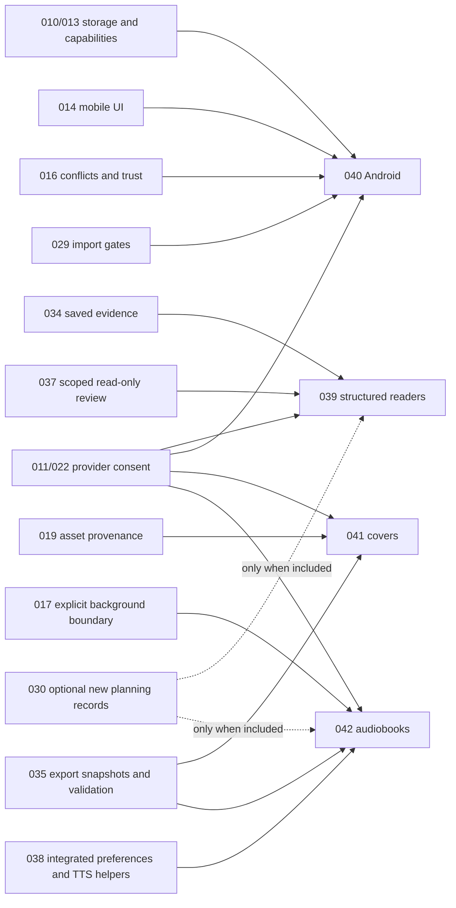

# Completion spec ownership and DAG

This map reconciles ownership against the November 7 status baseline in
[PRODUCT-COMPLETION.md](PRODUCT-COMPLETION.md). All new 039–042 tasks are unchecked. Existing specs
remain authoritative for their implemented slices and open decisions. Spec 038 is integrated through
PR #26 under D-192; its final verification task T022 remains open. The original review baseline and
results in [SPEC-REVIEW.md](SPEC-REVIEW.md) remain historical evidence.

## Requirement ownership

Every distilled requirement has one primary owner. Supporting specs provide existing contracts;
they are not replacement implementations. Acceptance criteria in
[completion-requirements.json](completion-requirements.json) remain binding completion checks.

| Requirement | Primary spec | Supporting contracts / remaining acceptance work | Lane |
| --- | --- | --- | --- |
| REQ-AUTO-001 | 037 | 030/031/033; short brief/onboarding to durable ~70,000-word drafting and revision workflow | L05 |
| REQ-AUTO-002 | 037 | 031/032/036; asynchronous specialists, background ownership/recovery and human direction | L05 |
| REQ-REVIEW-004 | 039 | 034/033/037; AutoCrit-style editorial workflow, exact source underlines and stale feedback | L09 |
| REQ-VOICE-002 | 017 | 038/031/037; hands-free activation, interruption, correction and spoken check-ins | L12 |
| REQ-TOOL-001 | 024 | 018/025; parity, opted-in writes/destruction, undo and single-writer conformance, not a new CLI/MCP | L15 |
| REQ-REVIEW-001 | 034 | Saved-only local metrics, stale/cancel/coverage and byte-identical sources; D-171 gates persistence | L08 |
| REQ-REVIEW-002 | 037 | 011/022/024/025; exact outgoing scope, zero-send cancel and read-only execution | L05 |
| REQ-REVIEW-003 | 039 (new) | 034/037 evidence and review boundaries; optional 030 planning sources; quote/profile/rerun attribution | L09 |
| REQ-VOICE-001 | 017 | Integrated 038 owns preferences; recording visibility, truthful fallback/refusal, no implied always-on listening | L12 |
| REQ-FORMAT-001 | 035 | 019 assets; immutable saved snapshot, folder export and failure-safe destinations | L11 |
| REQ-PUBLISH-001 | 035 | Named/versioned print and eBook rules, measurable inputs and unknowns; no implied KDP acceptance | L11 |
| REQ-ANDROID-001 | 040 (new) | 010/013/014/016/029; Android-specific save, lifecycle, credentials and supported-target matrix | L18 |
| REQ-COVER-001 | 041 (new) | 019/035; distinct book-level composition, original asset preservation and target geometry | L10 |
| REQ-AUDIOBOOK-001 | 042 (new) | 038 preferences and existing TTS helpers; 017 background boundary, 011/022 consent and 035 snapshot concepts; stock cast/text consent and recovery | L13 |
| REQ-LIBRARY-001 | 033 | 001/002; identity, unknown-field preservation, checked collections/notes/goals and stale anchors | L07 |
| REQ-HISTORY-001 | 032 | D-175/D-176 accepted; format/schema follow-through, conflict-preserving restore and undo/recovery remain | L07 |
| REQ-ROUTING-001 | 036 | 011/022; advisory-only preview, zero side effects and honest unknown price/capability; D-116 not a cap | L14 |
| REQ-RELEASE-001 | 009 | 013; signing/update decision gates, unsigned provenance and install/update library preservation | L20 |
| REQ-SURFACE-001 | 013 | 010/014/026/040; per-surface matrix and refusal before capture/request/write | L16 |

No remaining requirement is dropped merely because it already has a spec. Existing primary specs
retain their task lists; their completion must meet the additional named checks above and in the
requirements file. Accepted decision-only tasks may be reconciled against the register; that does
not complete their dependent implementation or resolve an open decision.

## Lane ownership

The completion DAG has 25 nodes, 63 unconditional prerequisite edges and three explicitly scoped
conditional edges. Its authoritative edge list is
[product-completion.json](product-completion.json); the Mermaid diagram in PRODUCT-COMPLETION.md
must match it. The machine-readable ownership map is [completion-specs.json](completion-specs.json).

| Lane | Spec owners / supporting documents |
| --- | --- |
| L00 Requirements and decisions | 002, 029–042; DECISIONS |
| L01 Identity and docs | 002, 013, 023; README and credential-identity compatibility |
| L02 Files, recovery and sync | 001, 010, 016, 028; FORMAT |
| L03 Models, keys and usage | 011, 022, 028 |
| L04 Editor, library and import | 002, 003, 010, 029, 033 |
| L05 Agent control and context | 002, 024, 025, 031, 037 |
| L06 Story Bible and series | 030; existing 002 records |
| L07 History, notes and goals | 032, 033 |
| L08 Deterministic review | 034 |
| L09 Readers and continuity | 039; 034/037 evidence, optional 030 planning records |
| L10 Illustrations and covers | 019, 041 |
| L11 Formatting and publishing | 035; optional 041 target inputs |
| L12 Voice and ambient | 017, 028, 038 preferences |
| L13 Voices and audiobooks | 042; integrated 038, TTS helpers and 017 background boundaries |
| L14 Routing and spend policy | 036, 011, 022 |
| L15 CLI and MCP conformance | 018, 024, 025, 026 |
| L16 Browser product | 010, 011, 013 |
| L17 iPhone and iPad | 014, 016 |
| L18 Android | 040; 010/013/014/016 |
| L19 Glasses and companion | 026; transport/hardware decisions remain gated |
| L20 Desktop packages and updates | 009, 013 |
| L21 Quality and accessibility | 012; exact-commit evidence |
| L22 Guides, samples and film | 021, 023 |
| L23 Desktop release sign-off | 009, 012, 013; release checklist |
| L24 Requested roadmap complete | All retained lanes or explicit public deferral |

## Reading the dependencies correctly

Solid arrows in the lane DAG gate final acceptance of each lane's **whole retained scope**, not all work
inside it. An already verified contract can satisfy a prerequisite; independent slices can proceed.
Dashed L14 → L09 does not authorize automatic routing or block a manually selected single-book review
on all of 036. Dashed L06 → L09 applies only to new planning records; dashed L06 → L13 applies only
to new character records, not a narrator-only audition. The JSON records their conditions explicitly.
L10 → L11 concerns cover-dependent target claims, not every existing document export. L12 → L18
concerns claimed voice support; an Android storage/editor slice can precede voice. Planned features
do not become desktop blockers through these edges: L23 accepts the explicitly supported desktop
matrix, while wider retained scope closes at L24. Any deferral must be recorded, not silently skipped.

The new specs' contract-level prerequisites are:

These contract arrows do not require full feature completion of all source specs. 035 supplies
snapshot/validation contracts to 041; 041 may later supply cover measurements to a 035 readiness
check. These are different slices, not a cycle requiring both entire specs to finish first. Likewise
037's conversational review and 039's structured reports remain distinct; neither changes 034's
deterministic metrics. D-171, D-115, D-116 and all new U-039…U-042 questions retain their open gates.

Spec 017 explicitly excludes TTS; 038 and the existing speech services supply selection/request
seams, not an audiobook job system. The all-features direction on November 7 adds L06 → L24 explicitly;
claim-scoped lane interpretations remain documented in
[the dependency notes](PRODUCT-COMPLETION.md#dependency-questions-still-open).
[CONCURRENT-DELIVERY.md](CONCURRENT-DELIVERY.md) and its JSON map independent execution packages to
every retained lane. Structural validity does not accept the open design decisions.

## Validation and review

Run `python3 scripts/validate-completion-specs.py` from the repository root. It validates acyclicity,
IDs/references, all requirement and lane ownership, reserved-spec treatment, new spec triplets,
and agreement between the machine DAG and both solid/dashed lane Mermaid edges. It checks cycles
in the union as well as the unconditional graph. It does not prove implementation
or accept decisions. Requested model review results must name the model/options and reviewed scope;
an unavailable review workflow is reported rather than impersonated. The requested model review,
findings, parent resolutions and validation limits are recorded in [SPEC-REVIEW.md](SPEC-REVIEW.md).
