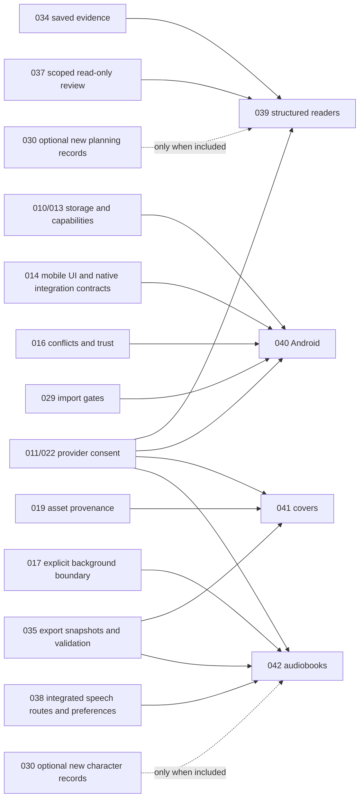

# Completion spec ownership and DAG

This map reconciles ownership against the November 9 status baseline in
[PRODUCT-COMPLETION.md](PRODUCT-COMPLETION.md). 039 is In progress: its retention decision is
checked and its continuation seams are merged, while its gate-owner tasks remain unchecked.
040–042 remain Draft/Planned with unchecked tasks. Existing specs
remain authoritative for their implemented slices and open decisions. Spec 038 is integrated through
PR #26 under D-192; its final verification task T022 remains open. The original review baseline and
results in [SPEC-REVIEW.md](SPEC-REVIEW.md) remain historical evidence.

## Requirement ownership

Every distilled requirement has one primary owner. Supporting specs provide existing contracts;
they are not replacement implementations. Linked numbers below open their principal spec; the
[spec index](../specs/README.md) also links plans and task lists, and the
[decision register](DECISIONS.md) distinguishes accepted from open decisions. Acceptance criteria in
[completion-requirements.json](completion-requirements.json) remain binding completion checks.

| Requirement | Primary spec | Supporting contracts / remaining acceptance work | Lane |
| --- | --- | --- | --- |
| REQ-AUTO-001 | [037] | [030]/[031]/[033]; short brief/onboarding to durable ~70,000-word drafting and revision workflow | L05 |
| REQ-AUTO-002 | [037] | [031]/[032]/[036]; asynchronous specialists, background ownership/recovery and human direction | L05 |
| REQ-REVIEW-004 | [039] | [034]/[033]/[037]; source-linked editorial workflow, exact source underlines and stale feedback | L09 |
| REQ-VOICE-002 | [017] | [038]/[031]/[037]; hands-free activation, interruption, correction and spoken check-ins | L12 |
| REQ-TOOL-001 | [024] | [018]/[025]; parity, opted-in writes/destruction, undo and single-writer conformance, not a new CLI/MCP | L15 |
| REQ-REVIEW-001 | [034] | Saved-only local metrics, stale/cancel/coverage and byte-identical sources; [D-199](DECISIONS.md#d-199--recoverable-explicit-review-retention) replaces [D-171](DECISIONS.md#d-171--report-save-export-retention-and-deletion), with implementation/evidence still required | L08 |
| REQ-REVIEW-002 | [037] | [011]/[022]/[024]/[025]; exact outgoing scope, zero-send cancel and read-only execution | L05 |
| REQ-REVIEW-003 | [039] (new) | [034]/[037] evidence and review boundaries; optional [030] planning sources; quote/profile/rerun attribution | L09 |
| REQ-VOICE-001 | [017] | Integrated [038] owns preferences; recording visibility, truthful fallback/refusal, no implied always-on listening | L12 |
| REQ-FORMAT-001 | [035] | [019] assets; immutable saved snapshot; folder export merged and usable on desktop, T016/T017/T019 acceptance remains | L11 |
| REQ-PUBLISH-001 | [035] | Named/versioned print and eBook rules, measurable inputs and unknowns; no implied KDP acceptance | L11 |
| REQ-ANDROID-001 | [040] (new) | [010]/[013]/[014]/[016]/[029]; Android-specific save, lifecycle, credentials and supported-target matrix | L18 |
| REQ-COVER-001 | [041] (new) | [019]/[035]; distinct book-level composition, original asset preservation and target geometry | L10 |
| REQ-AUDIOBOOK-001 | [042] (new) | [038] preferences and existing TTS helpers; [017] background boundary, [011]/[022] consent and [035] snapshot concepts; stock cast/text consent and recovery | L13 |
| REQ-LIBRARY-001 | [033] | [001]/[002]; identity, unknown-field preservation, checked collections/notes/goals and stale anchors | L07 |
| REQ-HISTORY-001 | [032] | Core merged PR #33; restore/UI correction accepted and merged in PR #34, host mount remains | L07 |
| REQ-ROUTING-001 | [036] | [011]/[022]; selection-neutral unranked preview, zero side effects and honest unknown price/capability. [D-116](DECISIONS.md#d-116--cost-and-usage-cap-enforcement): bounded operations allow disclosed unknown cost, not a dollar cap; strict money requires qualified all-charge bounds and durable reservations. Enforcement/qualification remain open. | L14 |
| REQ-RELEASE-001 | [009] | [013]; signing/update decision gates, unsigned provenance and install/update library preservation | L20 |
| REQ-SURFACE-001 | [013] | [010]/[014]/[026]/[040]; per-surface matrix and refusal before capture/request/write | L16 |

No remaining requirement is dropped merely because it already has a spec. Existing primary specs
retain their task lists; their completion must meet the additional named checks above and in the
requirements file. Accepted decision-only tasks may be reconciled against the register; that does
not complete their dependent implementation or resolve an open decision.

## Lane ownership

The completion DAG has 25 nodes, 63 solid contract-prerequisite edges and three explicitly scoped,
independent conditional edges. Its authoritative edge list is
[product-completion.json](product-completion.json); the Mermaid diagram in
[PRODUCT-COMPLETION.md](PRODUCT-COMPLETION.md#dependency-graph) must match it. The machine-readable
ownership map is [completion-specs.json](completion-specs.json). The
[edge acceptance register](PRODUCT-ACCEPTANCE-GATES.md) links each relationship to its owners and
states applicable claim, contract, evidence and refusal; the
[map rationale](PRODUCT-MAP-DESIGN.md) compares the design alternatives.

| Lane | Spec owners / supporting documents |
| --- | --- |
| L00 Requirements and decisions | [002], [029–042](../specs/README.md); [DECISIONS](DECISIONS.md) |
| L01 Identity and docs | [002], [013], [023]; [README](../README.md) and credential-identity compatibility |
| L02 Files, recovery and sync | [001], [010], [016], [028]; [FORMAT](FORMAT.md) |
| L03 Models, keys and usage | [011], [022], [028] |
| L04 Editor, library and import | [002], [003], [010], [029], [033] |
| L05 Agent control and context | [002], [024], [025], [031], [037] |
| L06 Story Bible and series | [030]; existing [002] records |
| L07 History, notes and goals | [032], [033] |
| L08 Deterministic review | [034] |
| L09 Readers and continuity | [039]; [034]/[037] evidence, optional [030] planning records |
| L10 Illustrations and covers | [019], [041] |
| L11 Formatting and publishing | [035]; optional [041] target inputs |
| L12 Voice and ambient | [017], [028], [038] preferences |
| L13 Voices and audiobooks | [042]; integrated [038], TTS helpers and [017] background boundaries |
| L14 Routing and spend policy | [036], [011], [022] |
| L15 CLI and MCP conformance | [018], [024], [025], [026] |
| L16 Browser product | [010], [011], [013] |
| L17 iPhone and iPad | [014] native storage, protected credentials, lifecycle/permission and capability/refusal integration; [010]/[013] shared ports/build contracts; [016] sync/trust |
| L18 Android | [040]; [010]/[013]/[014]/[016] |
| L19 Glasses and companion | [026]; transport/hardware decisions remain gated |
| L20 Desktop packages and updates | [009], [013] |
| L21 Quality and accessibility | [012]; exact-commit evidence |
| L22 Guides, samples and film | [021], [023] |
| L23 Desktop release sign-off | [009], [012], [013]; release checklist |
| L24 Requested roadmap complete | [All retained lanes](RETAINED-DELIVERY.md) or explicit author-approved scope change |

## Reading the dependencies correctly

Solid arrows in the lane DAG gate final acceptance of each lane's **whole retained scope**, not all work
inside it, and only the applicable contract is required. An already verified contract can satisfy a
prerequisite; independent slices can proceed. The [per-edge register](PRODUCT-ACCEPTANCE-GATES.md)
specifies applicability, upstream contract, evidence and refusal without asserting a pass.
Dashed L14 → L09 does not authorize automatic routing or block a manually selected single-book review
on all of 036. Dashed L06 → L09 applies only to new planning records; dashed L06 → L13 applies only
to new character records, not a narrator-only audition. The JSON records their conditions explicitly.
L10 → L11 concerns cover-dependent target claims, not every existing document export. L12 → L18
concerns claimed voice support; an Android storage/editor slice can precede voice. Planned features
do not become desktop blockers through these edges: L23 accepts the explicitly supported desktop
matrix, while wider retained scope closes at L24. Any deferral requires explicit author-approved scope
change, not delegated omission. [Retained follow-through](RETAINED-DELIVERY.md) assigns original gaps.
L24 also has a **direct conjunction** of retained-scope acceptance for each lane L00–L23, separate
from its eight sequencing arrows and from transitive reachability. A capability omitted from L23's
supported desktop matrix cannot thereby close its full retained lane or L24. The
[design rationale](PRODUCT-MAP-DESIGN.md) explains why these are distinct milestones.

The new specs' contract-level prerequisites are:

These contract arrows do not require full feature completion of all source specs. 035 supplies
snapshot/validation contracts to 041; 041 may later supply cover measurements to a 035 readiness
check. These are different slices, not a cycle requiring both entire specs to finish first. Likewise
037's durable conversational review needs shared thread safety; volatile 039's structured reports do
not depend on conversation persistence. They still need selected-source bounds, disclosure/consent,
citations, read-only execution and UI evidence. Neither changes 034's deterministic metrics. Explicit
campaign planning/execution and retained continuation have separate gates, as shown in the
[four review paths](DELIVERY-FORECAST.md#review-paths). D-171/D-116 and U-037/U-039 are specifically
accepted under ADRs 0019–0020; the detailed continuation format and its storage and check-in seams
are merged, while coordinator execution and independent evidence gates remain. No real coordinator
session exists yet, so the check-in channel and presenter refuse truthfully until one does. Three
authoring-contract gaps stay open: no word-count source for check-in targets, no cadence contract
and no stage-kind mapping. D-115 and U-040…U-042 retain open decisions.

Spec 017's D-200 extension now includes hands-free/reading; 038 and existing speech services supply
selection/request seams, not an audiobook job system. L12 → L13 links 038 as its speech-route owner;
042 also retains 017's explicit background boundary and its own request/storage/packaging decisions.
Native iOS work remains with 014; D-117 is Proposed and shell/Simulator evidence does not qualify
native storage, protected credentials or real-device/release behavior.
The November 7 direction adds L06 → L24 explicitly;
claim-scoped lane interpretations remain documented in
[the dependency notes](PRODUCT-COMPLETION.md#dependency-questions-still-open).
[CONCURRENT-DELIVERY.md](CONCURRENT-DELIVERY.md) and its JSON map independent execution packages to
every retained lane. Structural validity does not accept the open design decisions.

## Validation and review

Run `PYTHONDONTWRITEBYTECODE=1 python3 scripts/validate-completion-specs.py` from the repository root.
It validates acyclicity, IDs/references, all requirement and lane ownership, reserved-spec treatment,
new spec triplets, every edge record and linked owner, direct L24 obligations, and agreement between
the machine DAG and both solid/dashed lane Mermaid edges. It checks cycles in the union as well as the
unconditional graph. It checks structure and traceability, not the substance or passage of evidence,
implementation quality, release acceptance or open decisions. Requested model review results must name the model/options and reviewed scope;
an unavailable review workflow is reported rather than impersonated. The requested model review,
findings, parent resolutions and validation limits are recorded in [SPEC-REVIEW.md](SPEC-REVIEW.md).

[001]: ../specs/001-foundation/spec.md
[002]: ../specs/002-studio-v1/spec.md
[003]: ../specs/003-earlier-studio-import/spec.md
[009]: ../specs/009-packaging-release/spec.md
[010]: ../specs/010-web-target/spec.md
[011]: ../specs/011-model-access/spec.md
[012]: ../specs/012-automated-verification/spec.md
[013]: ../specs/013-builds-and-deployment/spec.md
[014]: ../specs/014-mobile/spec.md
[016]: ../specs/016-sync/spec.md
[017]: ../specs/017-voice-and-background/spec.md
[018]: ../specs/018-agent-toolkit/spec.md
[019]: ../specs/019-illustrations/spec.md
[021]: ../specs/021-product-film/spec.md
[022]: ../specs/022-provider-compatibility/spec.md
[023]: ../specs/023-submission/spec.md
[024]: ../specs/024-agent-tool-parity/spec.md
[025]: ../specs/025-agent-capabilities/spec.md
[026]: ../specs/026-glasses/spec.md
[028]: ../specs/028-integration-health/spec.md
[029]: ../specs/029-manuscript-import/spec.md
[030]: ../specs/030-story-bible-extensions/spec.md
[031]: ../specs/031-agent-interaction/spec.md
[032]: ../specs/032-chapter-history/spec.md
[033]: ../specs/033-library-organization/spec.md
[034]: ../specs/034-manuscript-review/spec.md
[035]: ../specs/035-book-formatting/spec.md
[036]: ../specs/036-task-aware-model-routing/spec.md
[037]: ../specs/037-guided-autonomous-authoring/spec.md
[038]: ../specs/038-voice-options/spec.md
[039]: ../specs/039-reader-continuity-review/spec.md
[040]: ../specs/040-android/spec.md
[041]: ../specs/041-cover-design/spec.md
[042]: ../specs/042-audiobook-casting/spec.md
