# Mobile layout captures

Reference captures from the real Electron renderer at the two target sizes. They are produced by
`scripts/capture.mjs`, which uses a throwaway profile and library, so no author data is touched.

| Device | Logical size | Layout |
| --- | --- | --- |
| iPhone | 393 × 852 | one column, bottom action bar, chapter drawer, full-screen agent |
| iPad mini | 744 × 1133 | chapter rail beside the manuscript, compact header, agent sheet |
| iPad mini landscape | 1133 × 744 | rail beside the manuscript, agent sheet |
| Desktop | 1440 × 900 | rail, manuscript and optional agent panel |

## iPhone

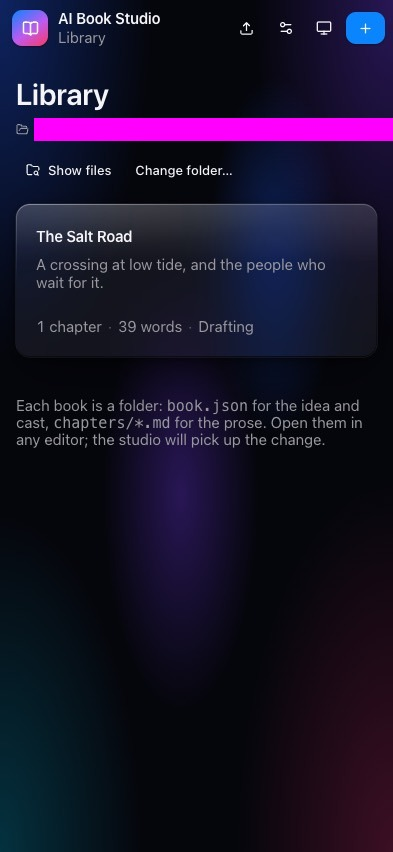

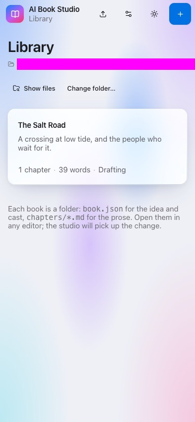

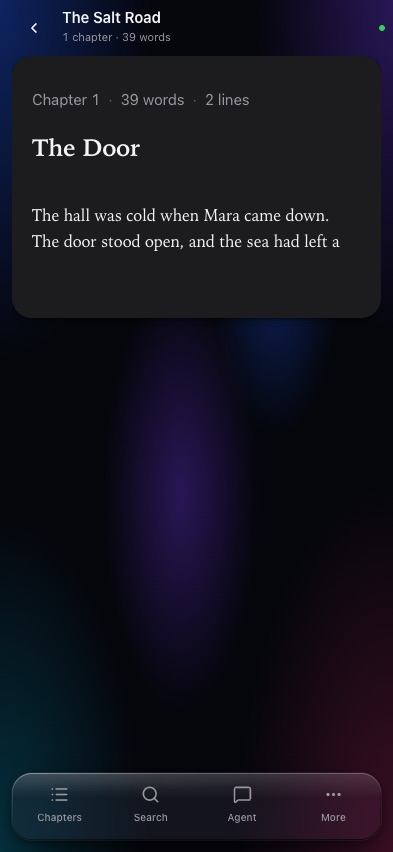

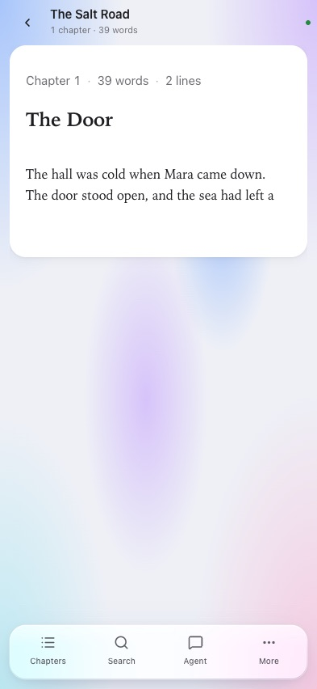

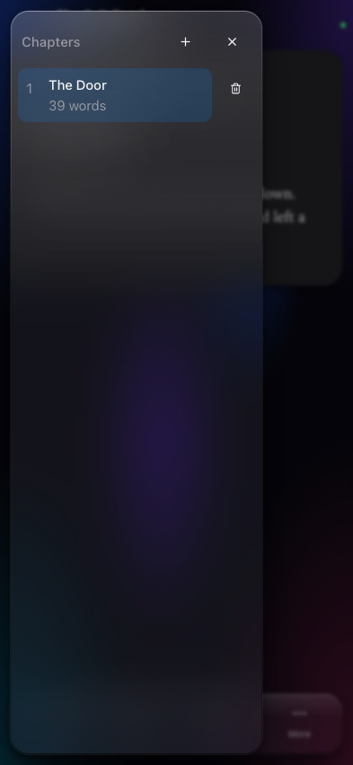

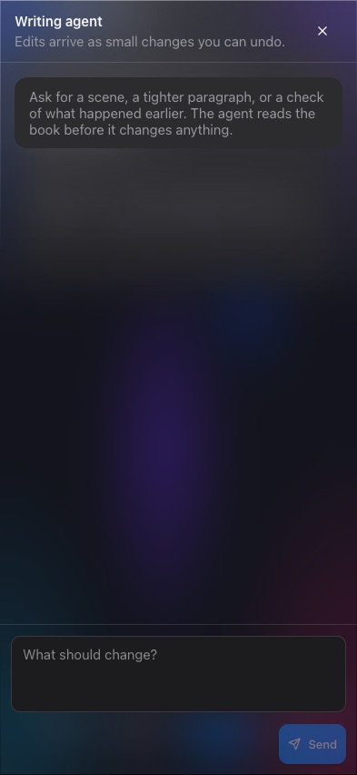

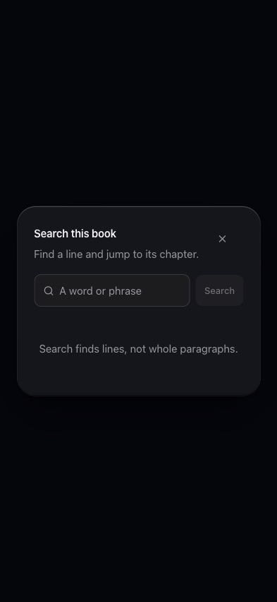

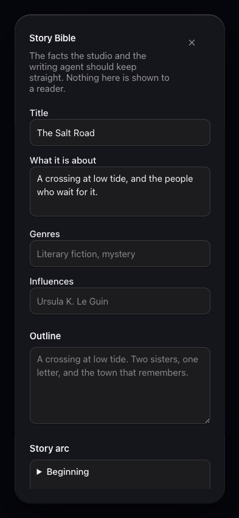

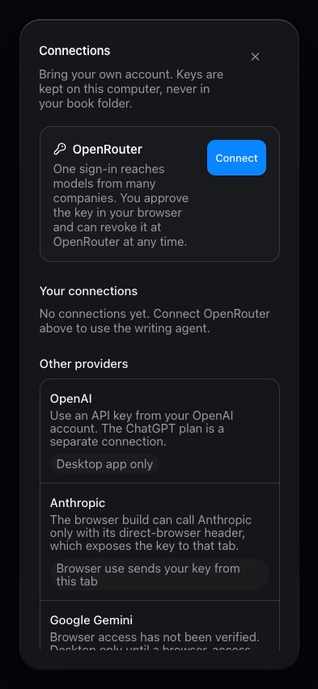

## iPad mini

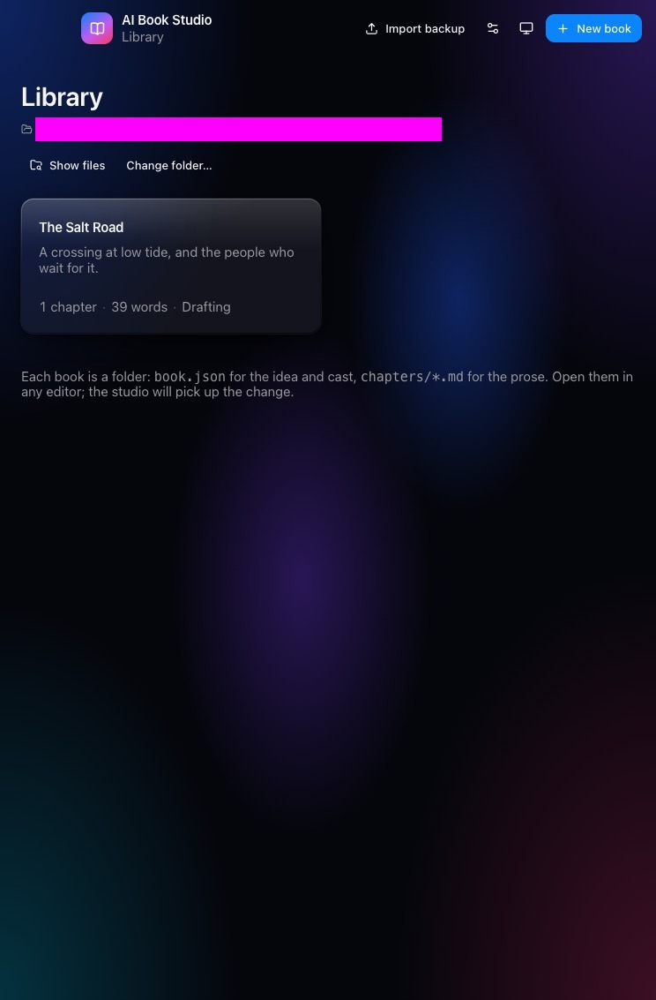

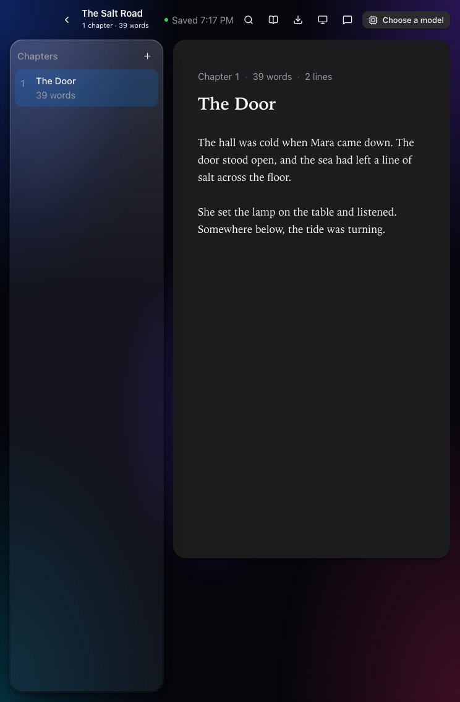

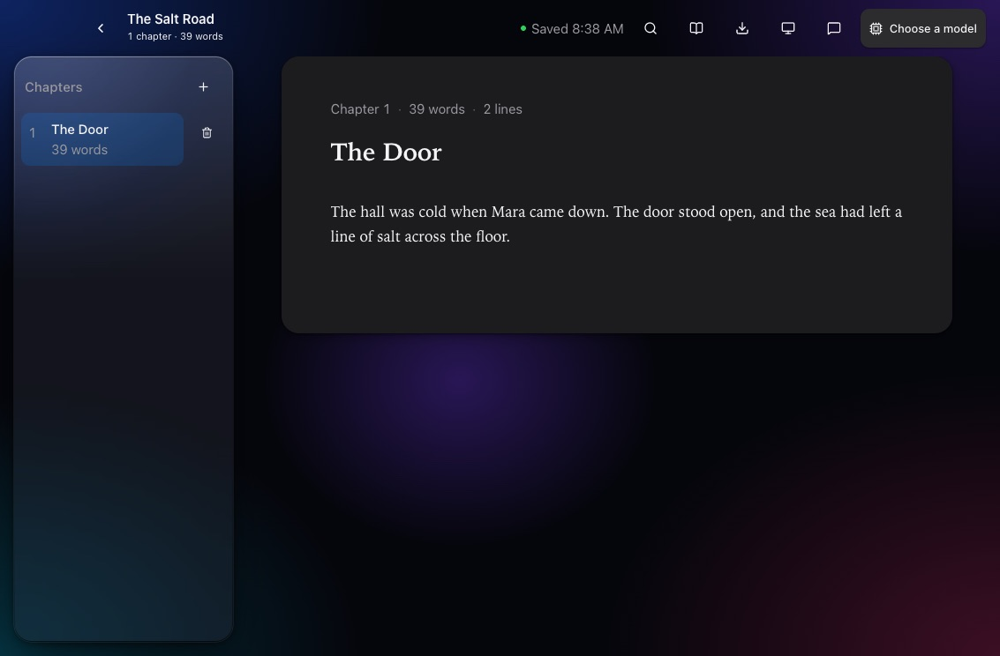

## Verified rotation and touch pass — 2026-10-25

Device: iPad mini (A17 Pro), iOS 26.5, Capacitor shell `studio.aibook.app`, portrait and
landscape-left. The simulator stayed on desktop 51; `device space` showed desktop 1 before and after,
and the Simulator window was never raised.

Procedure:

1. Open the app with `agent-device` and the named device.
2. Tap the chapter text and type ` Rotation check 2026-10-25.` with the on-screen keyboard.
3. Rotate to landscape-left while the edit is settling; snapshot; rotate back to portrait.
4. Check the same chapter, the marker in the text view, and the save status.

Observed: chapter 1 stayed selected; the text view kept `Ssfsffs11111 Rotation check 2026-10-25.`; the
header showed `1 chapter · 4 words` and `Saved 8:42 PM` in both orientations. Story Bible and Search
opened and closed by touch, and their controls exposed accessible names ("Story Bible", "Close",
"A word or phrase", "Search", "Add character", "Save changes", and the chapter delete button names its
chapter).

Still to verify for T015: the VoiceOver focus order across the rail, header and editor, and the
reduced-motion/reduced-transparency toggles. `simctl ui` has no reduced-motion option, so this needs
the Simulator's Settings app or a device pass.

Verification for T016: `bun run verify` (typecheck, 213 tests, desktop and web builds), `bun run smoke`
(14/14) and `node scripts/web-smoke.mjs` (10/10). The hidden runs use throwaway profiles and fixtures.

## Accessibility pass — 2026-10-25

- **Touch:** the theme control changed System → Light by tap; Story Bible and Search opened and closed
  by touch in the rotation pass. No hardware keyboard was used.
- **Labels and focus order:** the accessibility tree exposes names for the header, save state, chapter
  rail, editor, Story Bible, Search and their controls. The tree order follows the visual order:
  back/title/save/search/bible/export/theme/agent/model, then chapters, then the chapter title and text.
- **Reduced motion and transparency:** `ReduceMotionEnabled` and `ReduceTransparencyEnabled` were set on
  the iPad mini simulator and the shell was relaunched. The library restored, the book and chapter
  opened, and the theme control still responded. The web smoke now emulates both media features through
  CDP and asserts `--duration-fast: 0s` and `backdrop-filter: none` (11/11 checks).
- **Not run:** a human VoiceOver swipe-by-swipe pass. The accessibility tree above is what VoiceOver
  reads, but a person with VoiceOver enabled should still confirm the spoken order and hints.

## Reproduce

```bash
bun run build
bun scripts/capture.mjs 393x852 /tmp/iphone-library.png
bun scripts/capture.mjs 393x852 /tmp/iphone-workspace.png '[data-testid="book-card"]'
bun scripts/capture.mjs 393x852 /tmp/iphone-chat.png '[data-testid="book-card"]||[data-testid="mobile-agent"]'
bun scripts/capture.mjs 744x1133 /tmp/ipad-library.png
bun scripts/capture.mjs 744x1133 /tmp/ipad-workspace.png '[data-testid="book-card"]'
bun scripts/capture.mjs 1133x744 /tmp/ipad-landscape.png '[data-testid="book-card"]'
```

A selector can be chained with `||`; each one is clicked with a short pause before the screenshot.
Add `--coarse` to emulate a touch device. The run then asserts that every visible interactive control
is at least 44 × 44 and that the document has no horizontal overflow; it exits non-zero and prints the
offending controls when either check fails.

```bash
bun scripts/capture.mjs 393x852 /tmp/iphone-touch.png '[data-testid="book-card"]' --coarse
bun scripts/capture.mjs 744x1133 /tmp/ipad-touch.png '[data-testid="book-card"]' --coarse
```

## What the captures check

- The iPhone header fits back, title and save state without overflow; the save dot is labelled for
  assistive technology even when the text is hidden.
- The bottom bar exposes Chapters, Search, Agent and More with labels and 44px hit areas.
- The chapter drawer covers the workspace over a scrim, and the delete action is in the row rather
  than hidden behind hover.
- The agent is a full-screen sheet below 1000px; the hint hides before it can push Send off screen.
- The iPad mini keeps the chapter rail and a readable manuscript in both orientations.
- Dialogs stay inside `calc(100vw - 48px)`, scroll their content, and keep their actions reachable.
- The library path truncates instead of running past the right edge.

The full acceptance criteria are in [spec 014](../../specs/014-mobile/spec.md); the measured
touch-target audit is in [checklists/touch-targets.md](../../specs/014-mobile/checklists/touch-targets.md).
